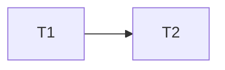
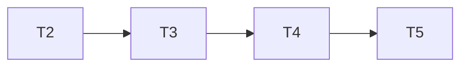

# Histórico de execução — Tasks

## Execution Protocol

Implementar seguindo a skill `tlc-spec-driven`, sem commits sem aprovação explícita.

## Test Coverage Matrix

> Fonte: AGENTS.md e testes unittest existentes.

| Code Layer | Required Test Type | Coverage Expectation | Location Pattern | Run Command |
| --- | --- | --- | --- | --- |
| Projeção e adaptação | unit | Critérios da spec e falhas | `tests/test_ui_history.py` | `python3 -m unittest tests.test_ui_history -v` |
| TUI | integration | Calendário, detalhe e resumo | `tests/test_ui_calendar*.py` | `python3 -m unittest tests.test_ui_calendar tests.test_ui_calendar_week -v` |

## Gate Check Commands

| Gate Level | When to Use | Command |
| --- | --- | --- |
| Quick | Projeção | `python3 -m unittest tests.test_ui_history -v` |
| Full | Integração TUI | `python3 -m unittest tests.test_ui_calendar tests.test_ui_calendar_week tests.test_ui_calendar_detail tests.test_ui_history -v` |
| Build | Conclusão | `python3 -m unittest discover -s tests -v` e `git diff --check` |

## Execution Plan

### Phase 1: Projeção

### Phase 2: Integração

## Task Breakdown

### T1: Vincular atividades por identidade

**Status**: Concluído; integração com a TUI ainda pendente nas tarefas seguintes.

**What**: Projetar atividades reais, duplicatas comprovadas e vínculos de execução tardia.
**Where**: `src/ui/history.py`
**Depends on**: None
**Requirement**: HIST-05, HIST-06, HIST-07, HIST-08, HIST-10, HIST-11
**Done when**: Fixtures verificam vínculo por ID, execução em outra data, manual não duplicado e múltiplos itens sem perda.
**Tests**: unit
**Gate**: Quick

### T2: Traduzir estrutura histórica

**What**: Traduzir evento e passos de potência suportados sem inventar dados.
**Where**: `src/ui/history.py`
**Depends on**: T1
**Requirement**: HIST-01, HIST-02, HIST-03
**Done when**: Fixtures cobrem evento válido, potência ausente e passos não suportados.
**Tests**: unit
**Gate**: Quick

### T3: Integrar fontes ao calendário

**What**: Carregar eventos e atividades com degradação explícita e preservar plano local.
**Where**: `src/ui/screens/calendar.py`
**Depends on**: T2
**Requirement**: HIST-01, HIST-04, HIST-11, HIST-12, HIST-13
**Done when**: Integração verifica dados, origem, divergência e falha de provider.
**Tests**: integration
**Gate**: Full

### T4: Apresentar gráficos e vínculos

**What**: Exibir perfis históricos e execução em outra data no calendário e detalhe.
**Where**: `src/ui/screens/calendar_detail.py`
**Depends on**: T3
**Requirement**: HIST-02, HIST-03, HIST-05, HIST-06
**Done when**: Testes de render verificam 02/11 e 03/11 e perfil indisponível.
**Tests**: integration
**Gate**: Full

### T5: Contabilizar resumo semanal

**What**: Contar prescrições e atividades na data correspondente sem duplicação.
**Where**: `src/ui/training_review.py`
**Depends on**: T4
**Requirement**: HIST-07, HIST-08, HIST-09, HIST-11
**Done when**: Testes verificam totais e múltiplas atividades.
**Tests**: unit
**Gate**: Build
