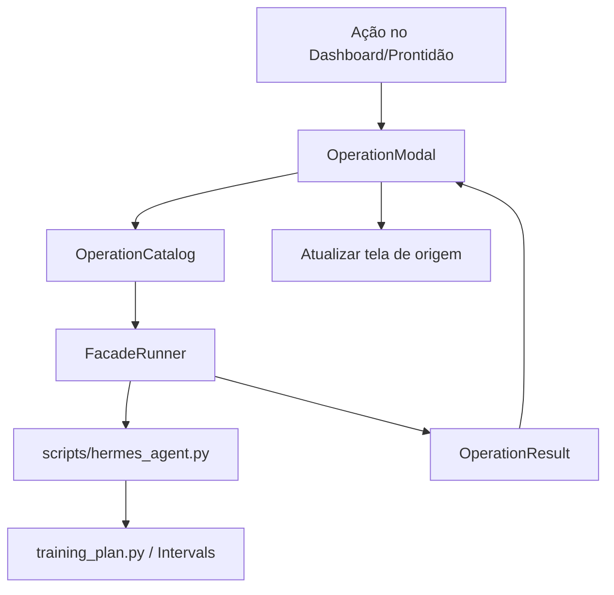

# Ações operacionais na TUI — Design

**Spec:** `.specs/features/ui-operational-actions/spec.md`
**Status:** Draft

---

## Architecture Overview

A TUI não conhece flags de domínio além de quatro operações declaradas. Um
adaptador local monta argv fixo para `scripts/hermes_agent.py`, executa sem
shell, captura o resultado e devolve um objeto imutável. A tela modal usa esse
resultado para conduzir prévia, confirmação e aplicação. O motor e o
Intervals.icu só são alcançados pela facade.



---

## Code Reuse Analysis

### Existing Components to Leverage

| Component | Location | How to Use |
|---|---|---|
| Facade de efeitos e confirmação | `scripts/hermes_agent.py` | Único subprocesso permitido; a TUI nunca chama `training_plan.py`. |
| Dashboard | `src/ui/screens/dashboard.py` | Substituir `notify` dos botões por abertura do modal. |
| Prontidão | `src/ui/screens/readiness.py` | Adicionar entrada para `check` com prévia e aplicação. |
| Launcher | `scripts/hermes_tui.py` | Mantém o mesmo entry point e raiz do projeto. |
| Textual screens/widgets | `src/ui/` | Seguir `Screen`, bindings e widgets já usados. |

### Integration Points

| System | Integration Method |
|---|---|
| Facade | `sys.executable scripts/hermes_agent.py <argv>` com `cwd=ROOT`, `shell=False`, stdout/stderr capturados. |
| Intervals.icu | Indireto: somente a facade pode acionar `push`. |
| Estado da TUI | Callback do modal informa sucesso; tela de origem faz reload de seus dados. |

---

## Components

### OperationCatalog e OperationResult

- **Purpose**: Declarar os argv permitidos e representar o resultado sem UI.
- **Location**: `src/ui/operations.py`.
- **Interfaces**:
  - `operation_preview(name: OperationName) -> tuple[str, ...]`
  - `operation_apply(name: OperationName) -> tuple[str, ...]`
  - `OperationResult(argv, returncode, stdout, stderr)`
  - `FacadeRunner.run(argv: Sequence[str]) -> OperationResult`
- **Dependencies**: `subprocess`, `sys`, `Path`.
- **Reuses**: comandos e classificação documentados em `scripts/hermes_agent.py`.

`build`, `check` e `reconcile` têm um único apply. `push` tem apply externo e
marca `requires_typed_confirmation=True`. Não há API genérica de shell nem
subcomando arbitrário.

### OperationModal

- **Purpose**: Exibir resultado da prévia, pedir confirmações e executar a
  aplicação em worker da TUI.
- **Location**: `src/ui/screens/operation.py`.
- **Interfaces**:
  - `OperationModal(operation: OperationName, on_complete: Callable)`
  - estados internos: `PREVIEWING`, `PREVIEW_READY`, `FIRST_CONFIRM`,
    `TYPED_CONFIRM`, `APPLYING`, `SUCCEEDED`, `FAILED`, `CANCELLED`.
- **Dependencies**: `OperationCatalog`, `FacadeRunner`, widgets de modal/Textual.
- **Reuses**: bindings e estilo das screens atuais.

O modal inicia somente a prévia. A aplicação não é agendada até que a confirmação
correta aconteça. Para push, a primeira confirmação revela o campo textual;
somente `PUBLICAR` habilita a aplicação. Durante execução, controles ficam
desabilitados e a saída é atualizada ao fim.

### Pontos de entrada de tela

- **Purpose**: Conectar ações existentes à operação declarada e recarregar a
  visualização após sucesso.
- **Location**: `src/ui/screens/dashboard.py` e `src/ui/screens/readiness.py`.
- **Interfaces**:
  - Dashboard: gerar plano, reconciliar, publicar.
  - Prontidão: check.
- **Dependencies**: `OperationModal`.
- **Reuses**: ações/botões já visíveis; não adiciona novo atalho mutável global.

---

## Data Models

```python
class OperationName(StrEnum):
    BUILD = "build"
    CHECK = "check"
    RECONCILE = "reconcile"
    PUSH = "push"

@dataclass(frozen=True)
class OperationSpec:
    preview_argv: tuple[str, ...]
    apply_argv: tuple[str, ...]
    external_write: bool
    typed_confirmation: str | None

@dataclass(frozen=True)
class OperationResult:
    argv: tuple[str, ...]
    returncode: int
    stdout: str
    stderr: str
```

`apply_argv` contém `--yes`; o catálogo é a única origem desse flag.

---

## Error Handling Strategy

| Error scenario | Handling | User impact |
|---|---|---|
| Executável/facade indisponível | Runner transforma `OSError` em `OperationResult` com código não zero e stderr | Modal mostra falha, sem fallback. |
| Prévia falha | Estado `FAILED`, saída legível, sem botão aplicar | Nenhuma mutação. |
| Aplicação falha | Estado `FAILED`, saída legível | Usuário decide tentar novamente em nova operação. |
| Cancelamento | Estado `CANCELLED`, sem subprocesso de apply | Nenhuma mutação. |
| Operação concorrente | Modal desabilita controles até conclusão | Não há duas mutações simultâneas pela mesma instância. |

---

## Risks & Concerns

| Concern | Location | Impact | Mitigation |
|---|---|---|---|
| `subprocess.run` síncrono bloqueia a TUI | `scripts/hermes_agent.py:86-90` | Terminal deixa de responder durante rede/push | Runner é chamado em worker Textual; UI só atualiza no retorno. |
| `--yes` pode pular confirmação da facade | `scripts/hermes_agent.py:103-114` | Escrita sem consentimento se houver bug de fluxo | Flag existe somente no catálogo apply; testes verificam que preview/cancelamento não o contêm. |
| Saída pode ser extensa | CLI/facade | Modal ilegível ou consumo excessivo | Truncar visualização a um limite explícito, preservando início/fim e indicar truncamento. |
| Não há testes atuais da TUI | `src/ui/` | Regressão de segurança de argv | Testes unitários do catálogo/runner e testes de estado do modal. |

---

## Tech Decisions

| Decision | Choice | Rationale |
|---|---|---|
| Execução | subprocesso da facade, sem shell | Mantém o contrato de efeito e elimina injeção por comando livre. |
| Confirmação | Modal da TUI + `--yes` somente após consentimento | Não depende de stdin concorrendo com o terminal Textual. |
| Concorrência | Um worker/modal por operação | A facade é síncrona e as mutações devem permanecer ordenadas. |
| Refresh | Callback explícito de sucesso | Evita estado de dashboard/prontidão obsoleto após aplicar. |

Nenhuma decisão é global nova: a fronteira de facade já é um contrato do projeto.
