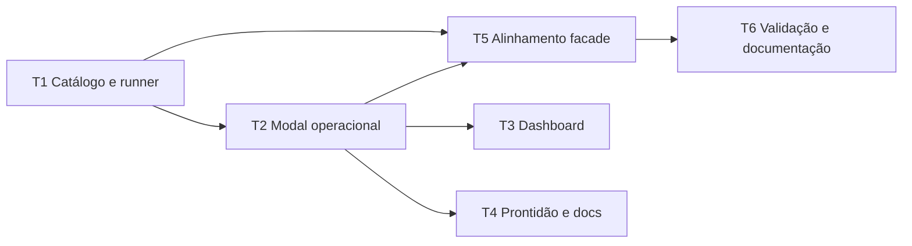

# Ações operacionais na TUI — Tasks

**Spec:** `.specs/features/ui-operational-actions/spec.md`
**Design:** `.specs/features/ui-operational-actions/design.md`

## Gate Check Commands

| Gate | Command |
|---|---|
| Quick | `python3 -m unittest tests.test_ui_operations -v` |
| Build | `python3 -m unittest discover -s tests -v` |

## Execution Plan

## Task Breakdown

### T1: Catálogo fechado e runner da facade

**Status:** Complete (`T1`)

**Depends on:** None

**Files:** `src/ui/operations.py`, `tests/test_ui_operations.py`,
`.specs/features/ui-operational-actions/{tasks,spec}.md`

**Tests:** prévias corretas para quatro ações; `--yes` somente nos argv de
apply; runner usa lista, raiz do repo, captura stdout/stderr/exit code e converte
`OSError` em falha.

**Done when:** UIOPS-01, UIOPS-02, UIOPS-03, UIOPS-06 e UIOPS-07 têm testes
unitários verdes.

**Gate:** Quick

**Commit:** `feat(ui): add facade operation runner`

### T2: Modal de prévia e confirmação

**Status:** Complete (`T2`)

**Depends on:** T1

**Files:** `src/ui/screens/operation.py`, `tests/test_ui_operations.py`,
`.specs/features/ui-operational-actions/{tasks,spec}.md`

**Tests:** prévia bem-sucedida habilita aplicação; prévia com falha não habilita;
cancelamento não chama apply; push exige continuidade e texto literal `PUBLICAR`;
estado em execução bloqueia novas transições.

**Done when:** UIOPS-04, UIOPS-05 e a história de publicação têm testes verdes.

**Gate:** Quick

**Commit:** `feat(ui): add guarded operation modal`

### T3: Ações do dashboard

**Status:** Complete (`T3`)

**Depends on:** T2

**Files:** `src/ui/screens/dashboard.py`, `tests/test_ui_operations.py`,
`.specs/features/ui-operational-actions/{tasks,spec}.md`

**Tests:** gerar, reconciliar e publicar abrem o modal com a operação declarada;
sucesso aciona reload de dashboard.

**Done when:** entradas do dashboard satisfazem UIOPS-01 a UIOPS-05 sem `notify`
de placeholder.

**Gate:** Quick

**Commit:** `feat(ui): connect dashboard operations`

### T4: Ação de check, manual e validação integrada

**Status:** Complete (`T4`)

**Depends on:** T2

**Files:** `src/ui/screens/readiness.py`, `docs/MANUAL-TUI.md`,
`tests/test_ui_operations.py`, `.specs/features/ui-operational-actions/{tasks,spec}.md`

**Tests:** a tela de prontidão abre `check`; sucesso atualiza a tela; gate completo
preserva toda a suíte.

**Done when:** UIOPS-01 a UIOPS-07 estão mapeados como completos; manual explica
prévia/confirmação; suíte completa passa.

**Gate:** Build

**Commit:** `feat(ui): add readiness check action`

### T5: Corrigir contrato da facade e observabilidade do modal

**Status:** Complete (`T5`)

**Depends on:** T1, T2

**Files:** `src/ui/operations.py`, `src/ui/screens/operation.py`,
`docs/MANUAL-TUI.md`, `tests/test_ui_operations.py`,
`.specs/features/ui-operational-actions/{tasks,spec}.md`

**Tests:** parser real aceita todo argv do catálogo; sucesso chama refresh;
saída mostra comando e exit code; durante apply não é possível cancelar o modal.

**Done when:** gaps bloqueantes de UIOPS-01, UIOPS-02, UIOPS-04, UIOPS-06 e
UIOPS-07 reportados pelo verificador estão corrigidos.

**Gate:** Build

**Commit:** `fix(ui): align operations with facade parser`

### T6: Fechar gaps da verificação independente

**Status:** Complete (`T6`)

**Depends on:** T5

**Files:** `src/ui/screens/operation.py`, `docs/MANUAL-TUI.md`,
`tests/test_ui_operations.py`, `.specs/features/ui-operational-actions/spec.md`,
`.specs/features/ui-operational-actions/tasks.md`

**Tests:** comando e exit code são renderizados; callback de sucesso continua
coberto; contrato EARS usa argv aceito pela facade.

**Done when:** spec, manual e modal descrevem o mesmo fluxo executável.

**Gate:** Quick

**Commit:** `fix(ui): close operation verification gaps`

## Test Coverage Matrix

| Requirement | Tests | Task |
|---|---|---|
| UIOPS-01 | argv de prévia e resultado capturado | T1 |
| UIOPS-02 | argv de apply contém `--yes` somente após fluxo confirmado | T1, T2 |
| UIOPS-03 | cancelamento e falha não iniciam apply | T2 |
| UIOPS-04 | push executa dry-run antes de confirmação | T1, T2 |
| UIOPS-05 | texto `PUBLICAR` controla push | T2 |
| UIOPS-06 | estado em execução bloqueia transição concorrente | T2 |
| UIOPS-07 | runner sem shell, erro de infraestrutura e refresh | T1, T3, T4 |
