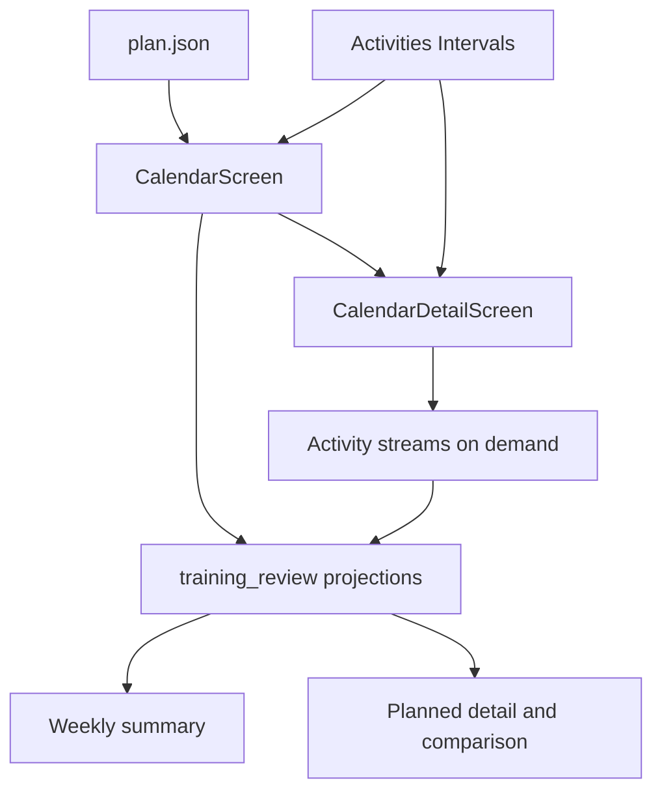

# Revisão de treino na TUI — Design

**Spec:** `.specs/features/ui-training-review/spec.md`
**Status:** Approved

## Architecture Overview

Uma projeção pura reúne plano, atividade e data de referência em um resumo de
dia ou semana. `CalendarScreen` continua responsável por carregar o plano e as
atividades; `CalendarDetailScreen` continua responsável por buscar streams sob
demanda. As duas telas renderizam os valores retornados pela projeção, sem
reimplementar status, totais ou mapeamento de zona.



## Code Reuse Analysis

### Existing Components to Leverage

| Component | Location | How to Use |
| --- | --- | --- |
| Calendar data merge | `src/ui/screens/calendar.py:_load_workouts` | Continua fonte de entradas `planned` e `done` por dia. |
| Activity stream reader | `src/ui/screens/calendar_detail.py:_load_activity_streams` | Mantém leitura sob demanda e cache por atividade. |
| Zone bands | `src/coach.py:ZONE_BANDS` | Fonte canônica para classificar potência relativa. |
| Detail zone formatter | `src/ui/screens/calendar_detail.py:_actual_zone_time`, `_zone_time` | Substituir por projeção compartilhada, preservando semântica de zonas. |
| Detail layout | `src/ui/screens/calendar_detail.py:_build` | Recebe seção planejada e comparação lado a lado. |

### Integration Points

| System | Integration Method |
| --- | --- |
| `plan.json` | `CalendarScreen` já carrega workouts e passa a entrada do dia ao detalhe. |
| Intervals.icu activities | `CalendarScreen` já carrega metadados de atividades para a janela necessária. |
| Intervals.icu streams | `CalendarDetailScreen` busca somente para a atividade aberta; resumo semanal aceita streams apenas quando obtidos. |

## Components

### Training review projections

- **Purpose:** Produzir resumos puros e testáveis de treino planejado,
  comparação diária, status e totais semanais.
- **Location:** `src/ui/training_review.py`
- **Interfaces:**
  - `planned_workout_summary(workout: dict) -> PlannedWorkoutSummary`
  - `day_comparison(planned: dict, done: dict) -> DayComparison`
  - `week_summary(entries: dict[str, dict], week_start: date, today: date, actual_zone_seconds: dict[str, dict[str, float]] | None) -> WeekSummary`
  - `zone_seconds_for_plan(workout: dict) -> dict[str, float]`
  - `zone_seconds_for_stream(points: list[tuple[float, float]], ftp: float | None) -> dict[str, float]`
- **Dependencies:** `src.coach.ZONE_BANDS` e constantes de foco.
- **Reuses:** Formato de `params`, bandas e classificação presentes no detalhe.

### Calendar weekly summary

- **Purpose:** Renderizar no topo da visão semanal totais planejados/realizados,
  status e distribuição por zona.
- **Location:** `src/ui/screens/calendar.py`
- **Interfaces:** `_week_summary(entries) -> WeekSummary` e `_render_week_summary(summary)`.
- **Dependencies:** `training_review`, cache de atividades e dados já carregados.
- **Reuses:** Grade semanal, navegação e fonte de dados atual.

### Planned detail and daily comparison

- **Purpose:** Mostrar estrutura planejada sempre que houver plano e comparação
  lado a lado quando houver atividade realizada.
- **Location:** `src/ui/screens/calendar_detail.py`
- **Interfaces:** `_render_planned_summary`, `_render_comparison` e uso das
  projeções compartilhadas.
- **Dependencies:** `training_review` e streams já carregados para visualizações
  reais existentes.
- **Reuses:** `_load_activity_streams`, `_profile`, cards e componentes de linha.

## Data Models

```python
@dataclass(frozen=True)
class PlannedWorkoutSummary:
    focus: str
    duration_seconds: int | None
    tss: float | None
    blocks: tuple[WorkoutBlock, ...]
    zone_seconds: dict[str, float]

@dataclass(frozen=True)
class DayComparison:
    planned_duration_seconds: int | None
    actual_duration_seconds: int | None
    duration_delta_seconds: int | None
    planned_tss: float | None
    actual_tss: float | None
    tss_delta: float | None
    average_watts: float | None
    normalized_power: float | None

@dataclass(frozen=True)
class WeekSummary:
    planned_duration_seconds: int
    actual_duration_seconds: int
    planned_tss: float
    actual_tss: float
    completed: int
    missed: int
    pending: int
    extra: int
    planned_zone_seconds: dict[str, float]
    actual_zone_seconds: dict[str, float] | None
```

`WorkoutBlock` representa somente os segmentos explicitamente existentes em
`params`: aquecimento, trabalho repetido, recuperação e desaquecimento.

## Error Handling Strategy

| Error scenario | Handling | User impact |
| --- | --- | --- |
| `params` ausentes ou incompletos | Omitir bloco/perfil dependente; manter foco, duração e TSS existentes. | Detalhe parcial, sem falha. |
| Atividade sem potência, NP ou TSS | Exibir `—` no campo ausente. | Comparação continua factual. |
| Stream indisponível | `actual_zone_seconds=None`. | Resumo semanal informa “Realizado: indisponível”. |
| Cliente Intervals falha | Capturar no boundary da tela, preservar projeções locais. | Plano e totais planejados permanecem visíveis. |

## Risks & Concerns

| Concern | Location | Impact | Mitigation |
| --- | --- | --- | --- |
| Lógica de zonas duplicada | `calendar_detail.py:292-321`, `:550-619`, `calendar.py:369-467` | Divergência visual e de totais. | Centralizar classificação e duração em `training_review.py`. |
| Estrutura planejada depende de zonas FC | `calendar_detail.py:696-743` | Treino futuro pode não mostrar blocos. | Renderizar estrutura como seção independente. |
| Streams no thread da interface | `calendar_detail.py:323-376` | Detalhe e semana podem bloquear em rede lenta. | Não adicionar fetch em lote ao calendário; semanal só usa streams já disponíveis no detalhe nesta entrega. |
| Ausência de testes de calendário fora do layout | `tests/` | Regressões nos cálculos factuais. | Cobrir todas as projeções puras e um teste de composição por tela. |

## Tech Decisions

| Decision | Choice | Rationale |
| --- | --- | --- |
| Limite de streams no resumo semanal | Não buscar streams em lote ao abrir a semana. | Evita N+1 remoto e preserva responsividade local-first. |
| Distribuição realizada sem streams | Declarar indisponível. | Não substituir dado real por estimativa. |
| Fonte de regras | `ZONE_BANDS` do motor. | Conforma à autoridade do motor determinístico. |
| Persistência | Nenhuma. | A feature é leitura e não cria estado de domínio. |
