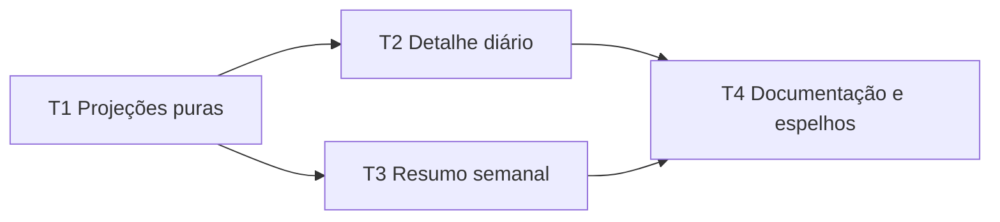

# Revisão de treino na TUI — Tasks

**Design:** `.specs/features/ui-training-review/design.md`
**Status:** Approved

## Test Coverage Matrix

> Generated from `AGENTS.md`, `.github/workflows/test.yml`, existing `unittest`
> tests and the specification. The project requires focused tests and the full
> CI-equivalent suite before finishing.

| Code Layer | Required Test Type | Coverage Expectation | Location Pattern | Run Command |
| --- | --- | --- | --- | --- |
| UI projection logic | unit | Every UIR acceptance criterion and listed data-absence edge case | `tests/test_training_review.py` | `python3 -m unittest tests.test_training_review -v` |
| Detail and calendar rendering | headless UI integration | One fixture per planned, compared and weekly state; verify visible factual text | `tests/test_ui_calendar_detail.py`, `tests/test_ui_calendar.py` | focused commands by screen |
| Full repository | CI-equivalent | All existing tests remain green | `tests/test_*.py` | `python3 -m unittest discover -s tests -v` |

## Gate Check Commands

| Gate | When | Command |
| --- | --- | --- |
| Quick | Projection task | `python3 -m unittest tests.test_training_review -v` |
| Full | Screen task | `python3 -m unittest tests.test_training_review tests.test_ui_calendar_detail -v` |
| Build | Final documentation/integration task | `python3 -m unittest discover -s tests -v` |

## Execution Plan

## Task Breakdown

### T1: Projeções factuais compartilhadas

**Status:** Complete (`T1`)

**What:** Criar as projeções puras de treino planejado, comparação, status,
totais semanais e tempo por zona.

**Where:** `src/ui/training_review.py`

**Tests at:** `tests/test_training_review.py`

**Depends on:** None

**Reuses:** `src/coach.py:ZONE_BANDS` e contratos `params`/atividades existentes.

**Requirements:** UIR-01, UIR-03, UIR-04, UIR-05, UIR-06, UIR-07, UIR-08,
UIR-09, UIR-10, UIR-11, UIR-12, UIR-13, UIR-14, UIR-15.

**Tools:** MCP: NONE. Skill: `tlc-spec-driven`.

**Done when:**

- [ ] O resumo planejado expõe somente blocos presentes e zona do plano.
- [ ] A comparação calcula duração/TSS e seus deltas, preservando ausências como `None`.
- [ ] A semana classifica realizado, perdido, pendente e extra conforme a data injetada.
- [ ] Zonas reais são calculadas somente de pontos com FTP válido.
- [ ] Pelo menos 10 testes unitários passam no gate Quick.

**Tests:** unit

**Gate:** Quick

**Commit:** `feat(ui): add training review projections`

### T2: Detalhe de plano e comparação diária

**Status:** Complete (`T2`)

**What:** Renderizar estrutura planejada independente de streams/FC e a
comparação Planejado × Realizado lado a lado no detalhe do calendário.

**Where:** `src/ui/screens/calendar_detail.py`

**Tests at:** `tests/test_ui_calendar_detail.py`

**Depends on:** T1

**Reuses:** `CalendarDetailScreen._load_activity_streams`, cards/linhas atuais e
projeções de `training_review`.

**Requirements:** UIR-01, UIR-02, UIR-03, UIR-04, UIR-05, UIR-06, UIR-07.

**Tools:** MCP: NONE. Skill: `tlc-spec-driven`.

**Done when:**

- [ ] Treino futuro mostra foco, duração, TSS, perfil e blocos existentes.
- [ ] Dia planejado e realizado mostra as duas colunas, métricas e deltas factuais.
- [ ] Métrica realizada ausente aparece como `—` sem ocultar as demais.
- [ ] Pelo menos 3 cenários headless passam no gate Full.

**Tests:** headless UI integration

**Gate:** Full

**Commit:** `feat(ui): show planned workout comparison`

### T3: Resumo da semana no calendário

**Status:** Complete (`T3`)

**What:** Renderizar no modo semanal os totais, estados e distribuição planejada
por zona, declarando distribuição realizada indisponível quando não houver
streams reais em cache.

**Where:** `src/ui/screens/calendar.py`

**Tests at:** `tests/test_ui_calendar.py`

**Depends on:** T1

**Reuses:** `CalendarScreen._load_workouts`, grade semanal e projeções de
`training_review`.

**Requirements:** UIR-08, UIR-09, UIR-10, UIR-11, UIR-12, UIR-13, UIR-14, UIR-15.

**Tools:** MCP: NONE. Skill: `tlc-spec-driven`.

**Done when:**

- [ ] Semana exibe totais planejados e realizados de duração e TSS.
- [ ] Semana exibe contagens de realizado, perdido, pendente e extra.
- [ ] Semana exibe zonas planejadas e o estado explícito para zonas realizadas indisponíveis.
- [ ] Navegar para outra semana recalcula o resumo pela janela visível.
- [ ] Pelo menos 2 cenários headless passam no gate Full.

**Tests:** headless UI integration

**Gate:** Full

**Commit:** `feat(ui): add weekly training summary`

### T4: Manual e cópias didáticas

**Status:** Pending

**What:** Documentar as leituras adicionadas e espelhar os dois arquivos de tela
canônicos em `docs/CODIGO-COMENTADO/`.

**Where:** `docs/MANUAL-TUI.md`

**Also updates:** `docs/CODIGO-COMENTADO/src/ui/screens/calendar.py`,
`docs/CODIGO-COMENTADO/src/ui/screens/calendar_detail.py`,
`.specs/features/ui-training-review/tasks.md` and
`.specs/features/ui-training-review/spec.md`

**Depends on:** T2, T3

**Reuses:** Convenção de cópias didáticas descrita em `AGENTS.md`.

**Requirements:** UIR-01, UIR-04, UIR-08.

**Tools:** MCP: NONE. Skill: `tlc-spec-driven`.

**Done when:**

- [ ] Manual explica detalhe planejado, comparação e totais semanais.
- [ ] Cópias didáticas diferem dos canônicos somente pelo cabeçalho próprio.
- [ ] Matriz de rastreabilidade marca UIR-01 a UIR-15 como Verified.
- [ ] Suíte CI-equivalente passa no gate Build.

**Tests:** headless UI integration

**Gate:** Build

**Commit:** `docs(ui): document training review`

## Task Granularity Check

| Task | Scope | Status |
| --- | --- | --- |
| T1 | Um módulo de projeção e seus testes | ✅ Granular |
| T2 | Um componente de detalhe e seus testes | ✅ Granular |
| T3 | Um componente de resumo semanal e seus testes | ✅ Granular |
| T4 | Documentação e espelhos da feature | ✅ Granular |

## Diagram-Definition Cross-Check

| Task | Depends on | Diagram shows | Status |
| --- | --- | --- | --- |
| T1 | None | Nenhuma entrada | ✅ Match |
| T2 | T1 | T1 → T2 | ✅ Match |
| T3 | T1 | T1 → T3 | ✅ Match |
| T4 | T2, T3 | T2 → T4, T3 → T4 | ✅ Match |

## Test Co-location Validation

| Task | Code layer | Matrix requires | Task says | Status |
| --- | --- | --- | --- | --- |
| T1 | UI projection logic | unit | unit | ✅ OK |
| T2 | Detail rendering | headless UI integration | headless UI integration | ✅ OK |
| T3 | Calendar rendering | headless UI integration | headless UI integration | ✅ OK |
| T4 | Documentation plus rendered behavior validation | headless UI integration | headless UI integration | ✅ OK |

## Test Coverage Matrix by Requirement

| Requirement | Tests | Task |
| --- | --- | --- |
| UIR-01 to UIR-03 | planned summary and missing-param fixtures | T1, T2 |
| UIR-04 to UIR-07 | comparison fixture with and without power | T1, T2 |
| UIR-08 to UIR-12 | weekly fixture with all status classes | T1, T3 |
| UIR-13 | planned zone fixture | T1, T3 |
| UIR-14 to UIR-15 | stream and unavailable-stream fixtures | T1, T3 |
