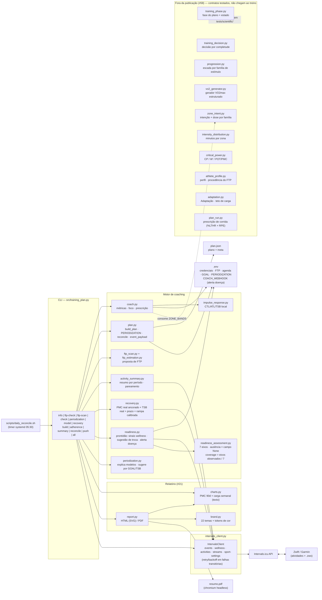
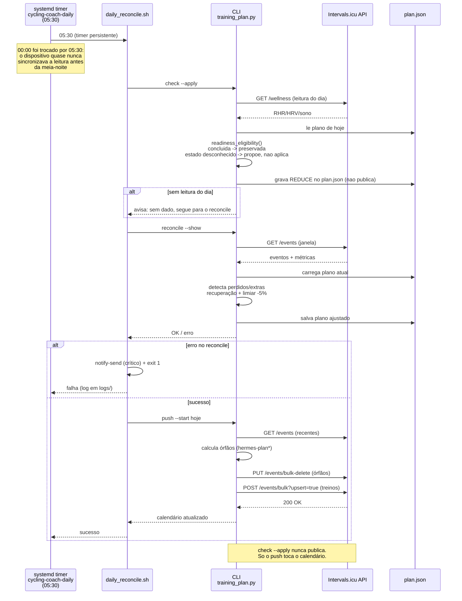
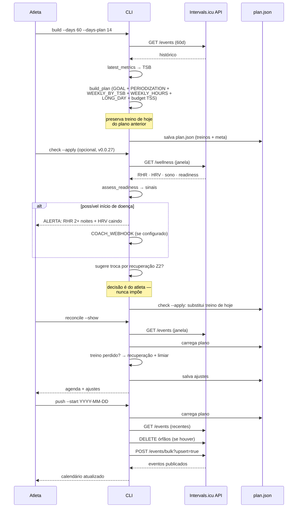
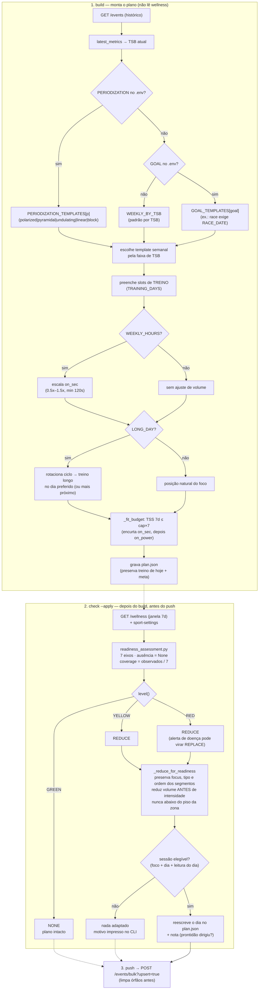
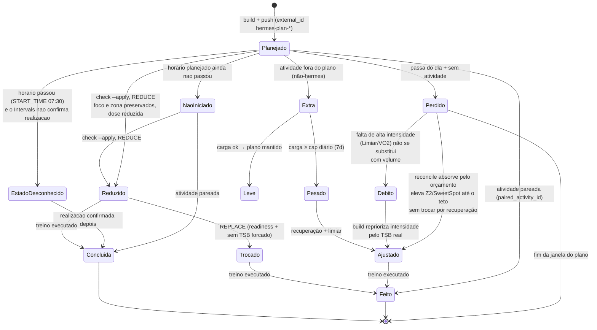

# Diagramas UML — Hermes Coach

Diagramas em [Mermaid](https://mermaid.js.org) do sistema real (v0.0.35).
Renderizam nativo no Obsidian (bloco ` ```mermaid `) e no GitHub. Os `.mmd`
fonte vivem em `docs/diagramas/` (geram os `.png` via mermaid-cli).

**Fonte canônica: este diretório no repo.** Os `.mmd` e `.png` são espelhados
em `01-Projetos/cycling-coach/` no vault do Obsidian para leitura; quando os dois
divergirem, o repo vence. Editar aqui e copiar — nunca editar os dois lados.
Os blocos `mermaid` deste `.md` são embutidos, não gerados: se um `.mmd` mudar,
atualizar o bloco correspondente aqui também.

Legenda rápida dos módulos:

| Módulo | Responsabilidade |
|---|---|
| `src/training_plan.py` | CLI: `info` / `ftp-check` / `ftp-scan` / `check` / `periodization` / `model` / `recovery` / `build` / `adherence` / `summary` / `reconcile` / `push` / `all` |
| `src/coach.py` | Métricas (TSB/CTL/ATL), foco do dia, prescrição (`WorkoutParams`), TSS estimado |
| `src/plan.py` | Plano semanal (`build_plan` + `PERIODIZATION`), ajuste por carga (`_fit_budget`), `reconcile`, texto do treino, `event_payload` |
| `src/impulse_response.py` | Motor Banister local (CTL/ATL/TSB) + séries diárias de TSS |
| `src/intervals_client.py` | Cliente da API do Intervals.icu (events, wellness, activities, streams, sport-settings) com retry/backoff |
| `src/ftp_scan.py` / `ftp_estimation.py` | Análise de treinos fora do plano → proposta de FTP (20min × 0,95) |
| `src/recovery.py` | Retorno a forma: PMC real ancorado (EWMA 42/7) + TSB real + prazo + rampa calibrada com deload (`estimate_return`/`ramp_schedule`/`calibrated_state`) |
| `src/readiness.py` | Prontidão do dia (`check`): sinais de wellness (RHR/HRV/sono) → proposta **REDUCE** (foco e zona preservados, dose reduzida), elegibilidade por estado da sessão, idempotência e alerta de início de doença (+ `COACH_WEBHOOK`) |
| `src/readiness_assessment.py` | Avaliação de prontidão do Passo A (`ReadinessAssessment`/`ReadinessLevel`). **Integração parcial**: chega ao fluxo por `check --apply`, não por `build` |
| `src/periodization.py` | Explicação dos 5 modelos de periodização (`periodization`): o que significam para o atleta + sugestão por GOAL/TSB (top/evitar) |
| `src/activity_summary.py` | Resumo dos treinos feitos por dia/semana/mês (`summary`) |
| `src/charts.py` | Gráficos em texto: PMC trailing 90d + carga semanal (TSS/ISO) |
| `src/report.py` | Relatório com gráficos SVG: HTML direto / PDF via chromium headless (`--export`) |
| `src/brand.py` | Identidade: 22 temas (Omarchy quattro) + tokens de cor por tema |
| `plan.json` | Estado local do plano (treinos + meta: goal, race_date, ftp_candidates) |
| `scripts/daily_reconcile.sh` | Timer systemd às **05:30**: `check --apply` (grava o plano, não publica) → `reconcile --show` → `push --start hoje` |

---

## 1. Diagrama de componentes (visão geral)



---

## 2. Sequência — fluxo diário automático (timer de 05:30)



---

## 3. Sequência — ciclo manual (build → reconcile → push)



---

## 4. Diagrama de classes (entidades com contrato verificado)

```mermaid
classDiagram
    direction LR

    class WorkoutParams {
        +str focus
        +int repeats
        +int on_sec
        +int off_sec
        +float on_power
        +float off_power
        +int warmup_sec
        +float on_power_pct
    }
    class PlannedWorkout {
        +str day
        +str focus
        +int planned_duration
        +str name
        +dict params
        +float tss
        +str external_id
    }
    class TrainingPlanState {
        +str start
        +float ftp
        +list workouts
        +dict meta
    }
    class ReadinessEligibility {
        +dict workout
        +str state
        +bool eligible
        +str reason
    }
    class Metrics {
        +float tsb
        +float ctl
        +float atl
        +float tss
        +float ftp
        +str day
    }
    class FtpTestSuggestion {
        +bool due
        +str reason
        +str day
    }

    class ReadinessLevel {
        <<enumeration>>
        GREEN
        YELLOW
        RED
    }
    class ReadinessAssessment {
        +float hrv_score
        +float rhr_score
        +float sleep_score
        +float subjective_fatigue_score
        +float recent_load_score
        +float performance_score
        +float consistency_score
    }
    class ReadinessAction {
        <<enumeration>>
        NONE
        REDUCE
        REPLACE
    }
    class ReadinessDecision {
        +ReadinessAction action
        +str reason
        +ReadinessLevel level
        +float coverage
        +bool illness_alert
        +bool composite_low
        +tuple observations
        +str applies_to_day
    }
    class Readiness {
        +ReadinessDecision decision
        +ReadinessObservation observation
    }
    class ReadinessObservation {
        +float hrv
        +float rhr
        +float sleep
        +str read_at
    }

    class ImpulseResponseEngine {
        +compute()
        +ctl_atl()
    }
    class TrainingLoadComponents {
        +float ctl
        +float atl
        +float tsb
    }

    class IntervalsClient {
        +get_events()
        +get_wellness()
        +get_activity()
        +get_streams()
        +create_events()
        +get_sport_settings()
    }
    class IntervalsApiError {
        +int status
        +str detail
    }
    class RideFtpEstimate {
        +float ftp
        +float ci
        +str method
    }

    class StimulusFamily {
        <<enumeration>>
        sweet_spot
        threshold
        vo2max
        endurance
        anaerobic
    }
    class ProgressionStep {
        +int repeats
        +int work_sec
        +float intensity
        +int recovery_sec
    }
    class CompletionScore {
        +float adherence
        +float intensity_ok
        +float total
    }
    class VO2Family {
        <<enumeration>>
        long_intervals
        short_intervals
        variable_intervals
    }
    class ProgressionLever {
        <<enumeration>>
        interval_duration
        repetitions
        total_work_time
        intensity
    }
    class VO2Workout {
        +VO2Family family
        +int interval_duration
        +int repetitions
        +tuple work_power_range
        +int recovery_duration
        +int total_work_time
        +int progression_step
        +ProgressionLever lever
    }

    class AdaptationState {
        +float aerobic_base
        +float threshold
        +float vo2max
        +float muscular_endurance
        +float anaerobic
        +float neuromuscular
    }
    class CriticalPowerProfile {
        +float critical_power
        +float w_prime
        +CPProtocol protocol
        +CPConfidence confidence
        +tuple test_dates
    }
    class AthletePhysiologicalProfile {
        +int ftp
        +FtpSource ftp_source
        +float ftp_confidence
    }
    class FtpSource {
        <<enumeration>>
        user
        ftp20
        ftp60
        ramp
        cp_estimate
        performance_estimate
    }
    class TrainingPhase {
        <<enumeration>>
        base
        build
        specific
        peak
        recovery
        test
    }
    class PhaseState {
        +TrainingPhase phase
        +int week
    }
    class TrainingDecision {
        +str goal
        +str phase
        +str primary_adaptation
        +str workout_family
        +int progression_step
        +int planned_duration
    }
    class IntensityDistributionModel {
        +float z1_minutes
        +float z2_minutes
        +float z3_minutes
        +float z4_minutes
        +float z5_minutes
    }
    class FamilyProfile {
        +str family
        +tuple band
        +ZoneLever lever
    }
    class ZoneLever {
        <<enumeration>>
        duration
        total_volume
        repetitions
        recovery
    }

    PlannedWorkout --> WorkoutParams : params (dict, contrato persistido)
    TrainingPlanState --> PlannedWorkout : workouts
    TrainingPlanState --> ReadinessEligibility : elegibilidade por dia
    Metrics --> TrainingLoadComponents : TSB/CTL/ATL
    ImpulseResponseEngine ..> TrainingLoadComponents : produz
    IntervalsClient ..> IntervalsApiError : levanta

    Readiness --> ReadinessDecision : decision
    Readiness --> ReadinessObservation : observation
    ReadinessDecision --> ReadinessAction : action
    ReadinessDecision --> ReadinessLevel : level
    ReadinessDecision ..> ReadinessEligibility : is_adaptive + applies_to_day
    ReadinessDecision --> WorkoutParams : REDUCE preserva focus
    PlannedWorkout --> ReadinessAssessment : 7 eixos lidos do wellness

    ProgressionStep --> StimulusFamily : pertence a
    CompletionScore ..> ProgressionStep : avaliado contra
    VO2Workout --> VO2Family : family
    VO2Workout --> ProgressionLever : lever
    VO2Workout ..> WorkoutParams : 4x4 / 5x3 / 3x5

    TrainingDecision --> TrainingPhase : phase
    TrainingPhase --> PhaseState : state
    TrainingDecision --> FamilyProfile : workout_family
    FamilyProfile --> ZoneLever : lever
    TrainingDecision ..> ProgressionStep : progression_step
    TrainingDecision ..> AthletePhysiologicalProfile : FTP
    AdaptationState ..> TrainingDecision : adaptações
    CriticalPowerProfile ..> TrainingDecision : CP/W' (fora da publicação)
    IntensityDistributionModel ..> TrainingDecision : minutos por zona
```



---

## 5. Diagrama de atividades — build, check --apply e push

Fluxo do `build`: do histórico ao plano publicado.



---

## 6. Diagrama de estados — ciclo de vida de um evento de treino



---

## Notas

- Diagramas gerados a partir do código real (`src/*.py`, suíte 793 OK) — não são
  genéricos. Se o código mudar, atualize aqui junto.
- Fontes em `docs/diagramas/*.mmd`; os `.png` são regenerados com mermaid-cli
  (`npx @mermaid-js/mermaid-cli -i X.mmd -o X.png -b white -s 1`, com
  `PUPPETEER_EXECUTABLE_PATH=/usr/bin/chromium`). Os blocos `mermaid` deste
  arquivo são gerados a partir dos `.mmd`, então o índice não diverge do fonte:
  edite o `.mmd`, regenere o PNG e sincronize o bloco.
- **O diagrama de classes é curado, não completo.** Entram só as entidades com
  contrato verificado por teste ou que vivem em formato persistido/externo
  (`plan.json`, payload do Intervals, `.env`). `src/` tem ~47 dataclasses; o
  critério está no cabeçalho de `classes.mmd`. **O diagrama de componentes marca
  os 10 módulos fora da publicação** (`OFF`), que `build`/`push` não importam —
  item 58 do `ROADMAP`, ainda aberto. Um diagrama que mostra só o que funciona
  é propaganda, não arquitetura.
- O `.zwo` **não é gerado localmente** (o Intervals monta no app a partir do
  texto de `description`).
- `plan.json` guarda a meta (goal, race_date, ftp_test_date, ftp_candidates)
  além dos treinos — o `reconcile` reescreve os dias sem mudar o tamanho do plano.
- A periodização (`PERIODIZATION`) é lida do `.env` no momento do `build` —
  não fica persistida na meta do `plan.json`.