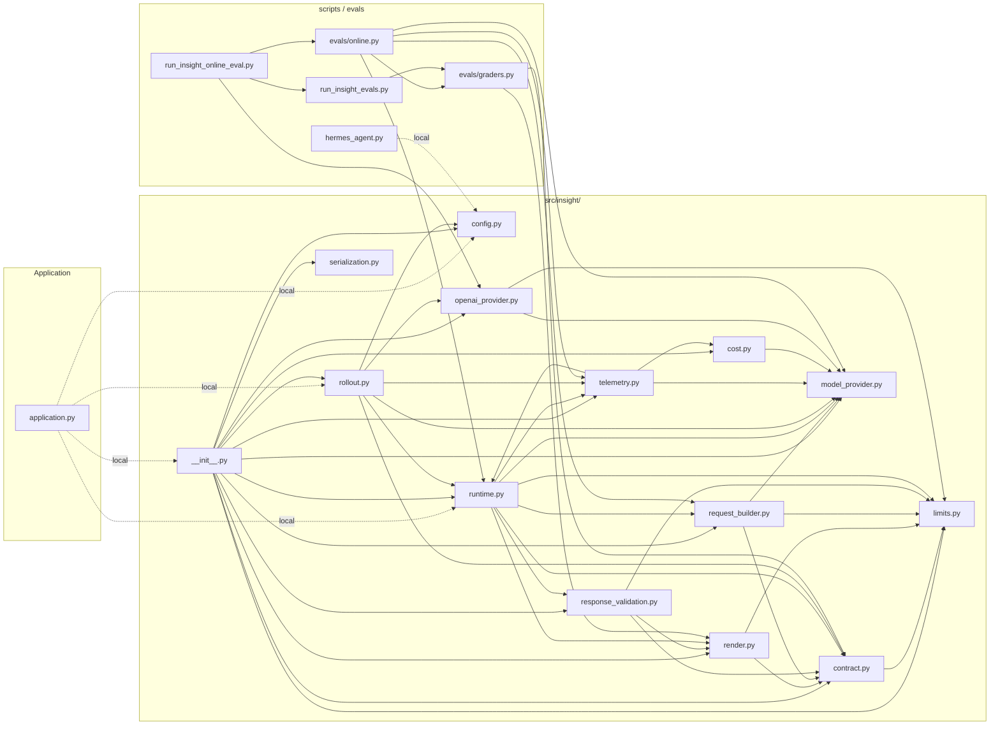
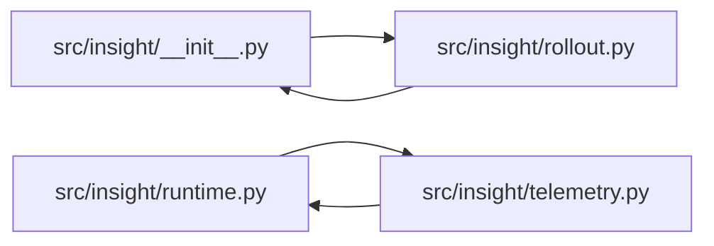
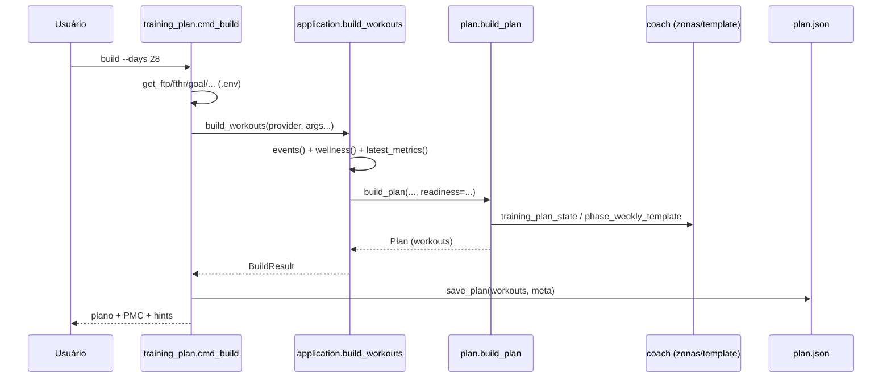
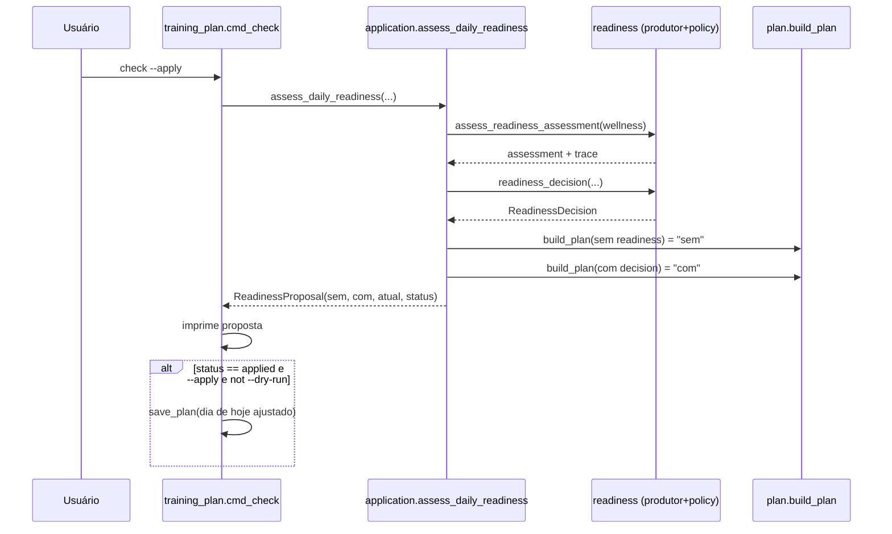
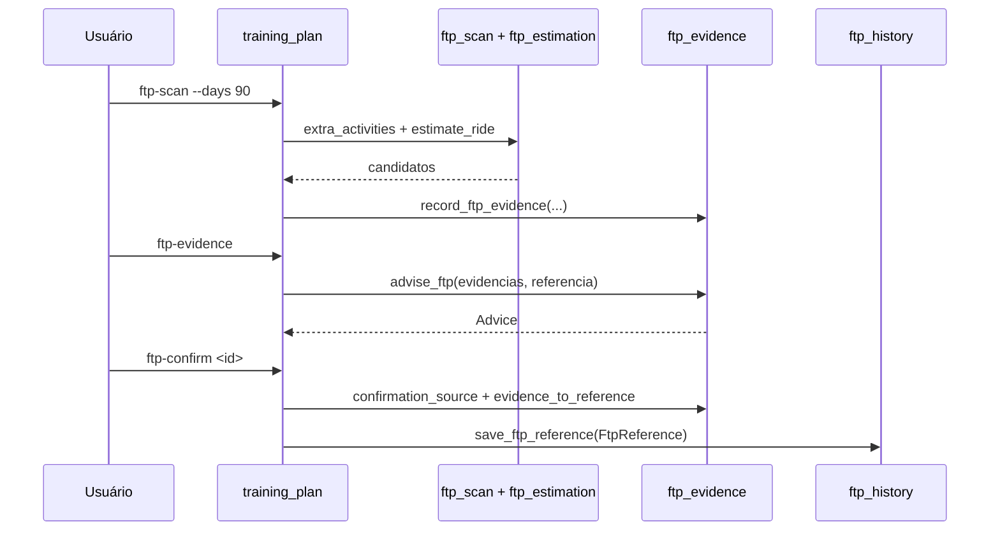
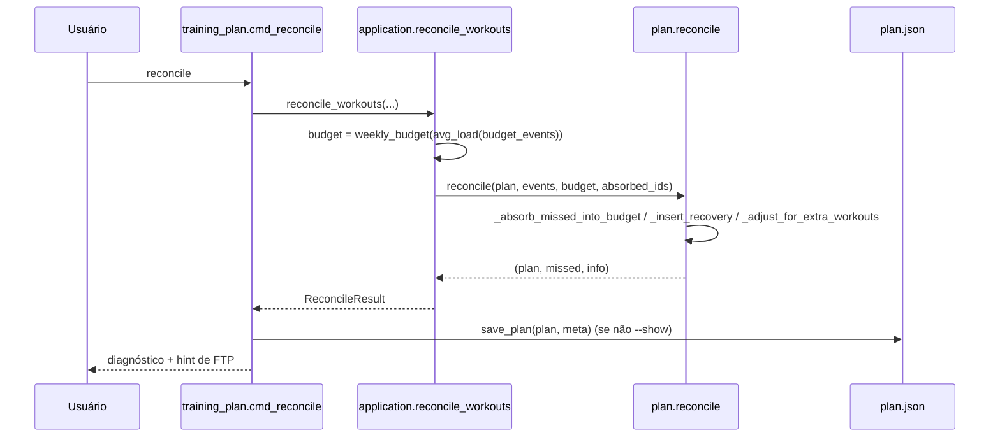
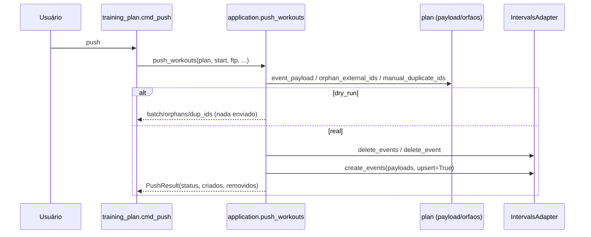

# Hermes Coach — Guia do Código Python

> **Dono deste documento:** `docs/GUIA-CODIGO-PYTHON.md` **no repo**.
>
> **Versão analisada:** `master` @ `b4ec54470d30cab4508e36a08d59f60b0d3e3810`
> (`VERSION` = `0.0.36`), commit de referência em `2026-10-20`.
>
> **Escopo:** todos os arquivos `.py` rastreados pelo Git — 142 arquivos, ~40.897
> linhas. Este documento foi produzido por **leitura efetiva do código**, não por
> inferência a partir do nome dos arquivos. Cada afirmação estrutural (dependência,
> símbolo, fluxo) é rastreável ao fonte na versão acima.
>
> **Manutenção:** este guia é uma **fotografia da versão `b4ec544`**. Ele não se
> atualiza sozinho. Quando um módulo `.py` for criado, removido, renomeado ou tiver
> sua responsabilidade alterada, o inventário (§2) e a descrição individual (§3)
> precisam ser atualizados no mesmo commit. Um documento de arquitetura desatualizado
> é pior que nenhum: ele ensina o mapa errado. Se a contagem de arquivos não bater
> com `git ls-files '*.py'`, considere o guia vencido.
>
> **Como usar este guia:** se você é novo no projeto, leia §1 (visão geral) e §5
> (onde alterar). Use §2 como índice e §3 para entender um arquivo específico. §4
> mostra como os comandos percorrem o código. §6 lista os riscos que o código já
> carrega hoje.

---

## 1. Visão geral

### 1.1 O que o sistema é

O Hermes Coach é um sistema de coaching de ciclismo que usa o **Intervals.icu** como
fonte de dados observados e como calendário de publicação. O motor de decisão de
treino é **determinístico** — não é um LLM. O LLM existe apenas em um subsistema
opcional e read-only (`src/insight/`), que transforma números já resolvidos em texto
de apresentação e nunca prescreve treino.

O sistema combina, em código:

- leitura de eventos, wellness, atividades e streams do Intervals.icu;
- geração determinística de plano (`build`);
- prontidão diária e adaptação da sessão de hoje (`check`);
- lifecycle local dos treinos;
- histórico canônico de FTP confirmado + evidências de FTP separadas;
- relatórios e resumos (terminal e HTML/PDF);
- reconciliação entre plano e atividades realizadas (`reconcile`);
- publicação de treinos no calendário (`push`);
- uma fachada local de orquestração segura (`scripts/hermes_agent.py`);
- um subsistema de apresentação com modelo, opcional e desligado por padrão
  (`src/insight/`).

### 1.2 Princípios arquiteturais observados no código

Estes princípios não são aspiracionais: eles aparecem como estrutura real no fonte e
são o que explica por que o código está organizado assim.

**a) View / Policy / Advice / Prescription são camadas distintas.**
O código separa o que é **observado/derivado** (Views em `src/ui_state.py`), do que é
**interpretação** (policy em `src/ctl_ramp_advisory.py`, `src/form_advisory.py`), do
que é **recomendação** (advice em `src/ftp_evidence.py::Advice`) e do que é
**prescrição** (o plano e o payload de evento). `src/insight/` é explicitamente
read-only e não participa de Prescription — seu contrato (`src/insight/contract.py`)
carrega a classificação `FactClassification`, e `InsightPresentation` não tem campos
de ação mutável.

**b) `missing != zero` e `planned != observed`.**
Ausência de dado não vira zero automaticamente. `src/ui_state.py` não atribui valor a
dado ausente; `src/pw_hr_decoupling.py` tem `UNAVAILABLE` separado de `NOT_ELIGIBLE`;
`src/insight/contract.py` separa `ObservationAvailability.OBSERVED` de `UNAVAILABLE`, e
`ObservedExecution` só recebe valor a partir de execução real, nunca do planejado.

**c) O motor determinístico é a fonte de verdade.**
A CLI (`src/training_plan.py`) e a fachada (`scripts/hermes_agent.py`) chamam o mesmo
motor. `scripts/hermes_agent.py` não contém lógica de negócio.

**d) O domínio não conhece o intervao do provider.**
`src/provider.py` define os contratos (`TrainingMetricsProvider`, `NormalizedRecord`,
`ProviderCapability`). O Intervals.icu concreto vive atrás de
`src/intervals_adapter.py`. Campos crus `icu_*` não devem vazar para o domínio.

**e) Guarda de import dual-mode.**
Esta é a característica estrutural mais importante e menos óbvia para um recém-chegado.
**Quase todos** os módulos de `src/` abrem com um par de imports `try/except`:

```python
try:
    from coach import (WorkoutParams, estimate_tss, ...)
except ImportError:
    from .coach import (WorkoutParams, estimate_tss, ...)
```

O primeiro ramo permite rodar o arquivo **como script solto** (com `src/` no
`sys.path`); o segundo permite importá-lo **como pacote** (`src.plan`). O mesmo padrão
aparece como `from . import plan / except ImportError: import plan` em `src/plan.py`.

Consequência prática: **o grafo de dependências só é correto lendo os dois ramos.**
`src/training_plan.py` ainda manipula `sys.path` explicitamente
(`PROJECT_ROOT = Path(__file__).resolve().parent.parent`) para que a execução como
script encontre os irmãos.

**f) Ausência de pacote formal em `src/`.**
`src/__init__.py` está **vazio**. O projeto não foi projetado como pacote instalável;
os módulos se resolvem por caminho. Isso é intencional e é o que torna o dual-mode
necessário.

### 1.3 Mapa resumido de diretórios e camadas

```text
cycling-coach/
├── src/                     # produção (61 arquivos)
│   ├── training_plan.py     # CLI / composition root
│   ├── application.py       # façade de casos de uso (Application + use-cases)
│   ├── plan.py              # motor de planejamento/reconcile/cue
│   ├── coach.py             # invariantes de zona/template/estado
│   ├── provider.py          # boundary do provider (contratos)
│   ├── intervals_adapter.py # adapter Intervals.icu
│   ├── intervals_client.py  # client HTTP legado
│   ├── ui_state.py          # View models (UI-5)
│   ├── report.py            # relatório HTML/PDF
│   ├── charts.py            # gráficos em texto (CLI)
│   ├── readiness*.py        # prontidão (heurística + policy)
│   ├── ftp_*.py             # FTP: history/evidence/estimation/scan
│   ├── *_advisory.py        # policy advisory opt-in
│   └── insight/             # subsistema LLM read-only (14 arquivos)
├── scripts/                 # CLI/orquestração (4 arquivos)
│   ├── hermes_agent.py      # fachada local determinística
│   ├── sync_vault_docs.py   # sincronizador repo -> vault
│   └── run_insight_*.py     # runners de eval
├── evals/                   # graders e runner online do INSIGHT (2 arquivos)
└── tests/                   # 81 arquivos (71 + tests/scientific/10)
```

**Camadas (do mais externo ao mais interno):**

| Camada | O que faz | Onde |
|---|---|---|
| Apresentação/orquestração | CLI, REPL, fachada, runners | `src/training_plan.py`, `scripts/` |
| Casos de uso | orquestração de um fluxo, sem I/O de apresentação | `src/application.py` |
| Domínio | regras de plano, zona, fase, carga | `src/plan.py`, `src/coach.py`, `src/training_phase.py`, `src/vo2_generator.py`, `src/zone_intent.py` |
| Persistência local | leitura/escrita de arquivos locais | `src/ftp_history.py`, `src/ftp_evidence.py`, `src/snapshot.py`, `src/activity_stream_cache.py`, `src/training_block.py` |
| Integração externa | boundary + adapter do Intervals | `src/provider.py`, `src/intervals_adapter.py`, `src/intervals_client.py` |
| Views/policy/advice | leitura pura, interpretação | `src/ui_state.py`, `src/*_advisory.py` |
| IA (opcional, read-only) | apresentação por modelo | `src/insight/`, `evals/` |

### 1.4 Implementado × apenas planejado

Nem tudo que aparece num documento de roadmap existe em código. Distinguir isso evita
que um novo dev procure por algo que não foi escrito.

**Implementado e verificável no código desta versão:**

- planejamento, readiness, FTP (evidência/histórico/scan/teste), reconcile, push,
  relatórios, resumo, recovery/rampa, model/aderência;
- lifecycle local, completion local, snapshot e freshness (UI-4), View models (UI-5);
- advisory opt-in: CTL ramp (HR-1), Form relativo (POL-1), Pw:HR (HR-2), tendências
  HRV/RHR (HR-3), wellness subjetivo (HR-4);
- o pacote `src/insight/` completo (contrato M1 v2 + runtime M2-3 + adapter OpenAI
  M2-5 + rollout M2-8 + telemetria/custo M2-6) e o harness de eval (`evals/`).

**Apenas planejado ou não integrado ao fluxo produtivo (verificado por `grep` — estes
módulos não são importados por `src/training_plan.py`, `src/application.py` nem
`src/plan.py`; só por testes):**

- `src/progression.py`, `src/training_decision.py`, `src/adaptation.py` e
  `src/intensity_distribution.py`: **existem e são testados**, mas nenhum fluxo de
  produção os consome. O `ROADMAP.md` registra os estados correspondentes —
  `AdaptationState` **BLOCKED**, `training_decision` **PARTIAL**, `progression`
  **NOT_READY_FOR_PRODUCTION** — e a integração prescritiva de progressão aguarda as
  decisões Q1–Q4 do treinador (`docs/SPEC-progression.md` documenta o contrato).
- `src/training_block.py`: é uma **boundary** persistida (`start_training_block`), mas
  ainda não dirige a prescrição diária.
- `src/critical_power.py`: usado por `athlete_profile`, sem fluxo de CLI ativo.
- roadmap de SaaS (`docs/ROADMAP-2-CRIACAO-DE-SAAS.md`) e portal UI
  (`docs/PORTAL-UI-DESIGN.md`): desenho, não código.

Regra de leitura: se um módulo aparece em §2/§3 mas não aparece em nenhum fluxo de §5,
isso é sinal de que ele é **folha** (consumido só por testes) ou **não integrado**, e o
texto da §3 diz qual dos dois. Nada nesta seção foi inferido do nome do arquivo: a
ausência de consumidor foi verificada por busca de import no repositório.

---

## 2. Inventário completo

Todos os **142** arquivos `.py` rastreados. A coluna *Categoria* usa:
**produção** (código de domínio/serviço em `src/`), **CLI/orquestração** (`scripts/`,
`src/training_plan.py`), **IA** (`src/insight/`, `evals/`), **teste** (`tests/`),
**teste científico** (`tests/scientific/`), **infra** (`__init__.py`).

### 2.1 Produção — `src/` (41 arquivos)

| Arquivo | Categoria | Responsabilidade | Principais dependências | Utilizado por |
|---|---|---|---|---|
| `src/__init__.py` | infra | Pacote vazio; marca `src` como pacote importável. Sem lógica. | — | dual-mode de import dos módulos |
| `src/activity_stream_cache.py` | persistência | Cache local de streams observados por provider+activity. | `provider` | `application`, testes |
| `src/activity_summary.py` | domínio | Resume atividades feitas por período (dia/semana/mês/…/plan). | — | `application.summarize_period`, `training_plan` |
| `src/adaptation.py` | domínio | Estado heurístico de adaptação de estímulo (não medição fisiológica). | — | testes (folha) |
| `src/application.py` | produção (façade) | Casos de uso + `Application`: orquestra plan/readiness/ftp/views. | `plan`, `training_plan`, `ui_state`, `snapshot`, `ftp_*`, `insight`, `provider*` | `training_plan`, `hermes_agent` |
| `src/athlete_profile.py` | domínio | Perfil fisiológico explícito; ausentes ficam desconhecidos. | — | `application` |
| `src/brand.py` | produção (tokens) | Design tokens (22 temas) para relatório e futuro SaaS. | — | `report` |
| `src/charts.py` | apresentação | Gráficos em texto (sparkline/PMC/carga) para o CLI. | — | `training_plan` |
| `src/coach.py` | domínio | Invariantes de zona (`ZONE_BANDS`), templates, estado do plano. | — | `plan`, `zone_intent`, `training_plan`, `training_phase` |
| `src/critical_power.py` | domínio | Critical Power / W' complementares ao FTP (nunca equivalentes). | — | `application`(indireto), testes |
| `src/ctl_ramp_advisory.py` | policy | Advisory opt-in da taxa de CTL; não conhece plano/provider. | — | `application` |
| `src/form_advisory.py` | policy | Advisory opt-in do Form relativo (`form_pct` já derivado). | — | `application` |
| `src/ftp_estimation.py` | domínio | Estimativa pura de FTP (melhor 20 min × 0,95) e gates. | — | `ftp_scan`, `training_plan` |
| `src/ftp_evidence.py` | persistência/advice | Evidência de FTP + `Advice`; ponte só por confirmação. | — | `application`, `training_plan` |
| `src/ftp_history.py` | persistência | Histórico canônico de referências de FTP confirmadas. | — | `application`, `training_plan` |
| `src/ftp_scan.py` | integração | Detecta candidatos a novo FTP em treinos fora do plano. | `ftp_estimation`(via caller) | `training_plan` |
| `src/impulse_response.py` | domínio | Modelo Banister: TSS, CTL/ATL/TSB (EWMA 42/7). | — | `training_plan`, `ui_state`(campos) |
| `src/intensity_distribution.py` | domínio | Distribuição de intensidade por tempo efetivo; modelos são rótulos. | — | testes (folha) |
| `src/intervals_adapter.py` | integração | Adapter concreto Intervals.icu (normaliza para o boundary). | `provider`, `requests` | `training_plan.get_provider` |
| `src/intervals_client.py` | integração | Client HTTP legado com retry/backoff. | `requests` | `training_plan.get_client` |
| `src/lifecycle.py` | domínio | Lifecycle declarado do treino + transições + completion local. | — | `application`, `plan` |
| `src/periodization.py` | apresentação/domínio | Explica os 5 modelos de periodização e sugere para o GOAL. | — | `training_plan` |
| `src/plan.py` | domínio (núcleo) | Motor: build_plan, reconcile, eventos, cue, guards FTP-H3/H8. | `coach`, `readiness`, `zone_intent`, `lifecycle`, `training_phase`, `provider_fields` | `application`, `training_plan` |
| `src/plan_run.py` | domínio | Treinos de corrida (%LTHR + RPE), esporte #2. | — | `training_plan`(run) |
| `src/progression.py` | domínio | Progressão de estímulos como heurística configurável. | — | testes (folha) |
| `src/provider.py` | integração (boundary) | Contratos provider-independent: records, protocols, capabilities. | (stdlib) | `application`, `plan`, `intervals_adapter`, todos |
| `src/provider_fields.py` | integração | Acesso canônico a campos; tolera record e dict legado. | — | `application`, `plan` |
| `src/pw_hr_decoupling.py` | domínio (HR-2) | Pw:HR observacional sobre streams normalizados. | `provider`(tipo) | `application` |
| `src/readiness.py` | domínio/policy | Prontidão wellness→decisão; produtor e policy explícita. | — | `plan`, `application`, `training_plan` |
| `src/readiness_assessment.py` | domínio | Modelo multimodal de prontidão (7 eixos) + níveis/confiança. | — | `readiness`, `ui_state` |
| `src/recovery.py` | domínio | Reconstrução do PMC real e rampa de retorno (legado; ver AUD-01). | — | `application`, `training_plan` |
| `src/report.py` | apresentação | Relatório HTML/PDF com SVG inline; sem dependências. | `brand` | `training_plan` |
| `src/snapshot.py` | persistência | Snapshot normalizado do estado externo + freshness (UI-4). | — | `application` |
| `src/training_block.py` | domínio (FTP-H3) | Boundary persistida do bloco (BlockContext); sem policy. | — | `application`, testes |
| `src/training_decision.py` | domínio | Decisão adaptativa explicável isolada (boundary). | — | testes (folha) |
| `src/training_phase.py` | domínio | Fases configuráveis + engine de transição. | — | `plan`, `application` |
| `src/training_plan.py` | CLI/orquestração | Composition root: argparse, cmd_*, get_* do env, push. | `application`, `plan`, `coach`, `report`, `charts`, `recovery`, `periodization`, … | `main`, testes |
| `src/ui_state.py` | apresentação (UI-5) | View models imutáveis + ApplicationState (consultas puras). | `readiness`(tardio) | `application` |
| `src/vo2_generator.py` | domínio | Gerador estruturado de VO2max (templates configuráveis). | — | `plan`, testes |
| `src/workout_identity.py` | domínio | `HermesWorkoutId`: UUIDv5 estável, independente do provider. | — | `application` |
| `src/zone_intent.py` | domínio | Intenção e dose por família (ENDURANCE/SWEET_SPOT/THRESHOLD). | `coach` | `plan`, testes |

### 2.2 IA — `src/insight/` (14 arquivos)

| Arquivo | Categoria | Responsabilidade | Principais dependências | Utilizado por |
|---|---|---|---|---|
| `src/insight/__init__.py` | IA (infra) | Fachada que reexporta os contratos/adapters do pacote. | todos os módulos `insight/*` | `application`, `scripts/` |
| `src/insight/config.py` | IA | Config fail-closed do rollout (flags, modelo fixo, credencial). | — | `rollout`, `application`, `hermes_agent` |
| `src/insight/contract.py` | IA | Contrato offline/read-only: `InsightView`, `InsightFact`, classificações. | `limits` | quase todo o pacote, `evals` |
| `src/insight/cost.py` | IA | Custo estimado puro (só `usage` observado + tabela versionada). | `model_provider` | `telemetry` |
| `src/insight/limits.py` | IA | Limites operacionais e helpers de tamanho (bytes/UTF-8). | — | todo o pacote |
| `src/insight/model_provider.py` | IA | Contratos neutros de provider de modelo (`Protocol`, erros, provenance). | `limits` | `runtime`, `rollout`, `openai_provider`, `evals` |
| `src/insight/openai_provider.py` | IA | Adapter OpenAI (Responses API); tipos do vendor não escapam. | `limits`, `model_provider` | `rollout`, `run_insight_online_eval` |
| `src/insight/render.py` | IA | Renderer determinístico de placeholders + fallback estático. | `contract`, `limits` | `runtime`, `response_validation`, `graders` |
| `src/insight/request_builder.py` | IA | Constrói `InsightModelRequest` puro (egress allowlisted, SHA do prompt). | `contract`, `limits`, `model_provider` | `runtime`, `evals` |
| `src/insight/response_validation.py` | IA | Decoder estrito + validação de template + render local (M2-2). | `contract`, `limits`, `render` | `runtime` |
| `src/insight/rollout.py` | IA | Composição config+adapter+runtime; autorização dupla. | `config`, `contract`, `model_provider`, `openai_provider`, `runtime`, `telemetry` | `__init__`, `application` |
| `src/insight/runtime.py` | IA | Runtime provider-neutral: no máx. 1 tentativa, status fechado (M2-3). | `contract`, `limits`, `model_provider`, `render`, `request_builder`, `response_validation`, `telemetry` | `rollout`, `evals` |
| `src/insight/serialization.py` | IA | Serialização canônica e limitada do `InsightView`. | `contract`, `limits` | `__init__`, testes |
| `src/insight/telemetry.py` | IA | Telemetria sanitizada (sem prompt/payload/segredo), opcional. | `cost`, `model_provider`, `runtime` | `runtime`, `rollout`, `evals` |

### 2.3 CLI/orquestração e evals — `scripts/`, `evals/` (6 arquivos)

| Arquivo | Categoria | Responsabilidade | Principais dependências | Utilizado por |
|---|---|---|---|---|
| `evals/graders.py` | IA (eval) | Graders determinísticos/domínio do INSIGHT (schema, proibições, contradição). | `insight.contract`, `insight.render` | `evals.online`, `run_insight_evals` |
| `evals/online.py` | IA (eval) | Runner de avaliação online com dados reais de modelo. | `graders`, `insight.{model_provider,request_builder,runtime,telemetry}` | `run_insight_online_eval` |
| `scripts/hermes_agent.py` | CLI/orquestração | Fachada determinística: classifica efeitos, confirma mutações, despacha CLI. | `application`, `insight.config` (local) | usuário, testes |
| `scripts/run_insight_evals.py` | CLI/eval | Runner offline dos fixtures de eval do INSIGHT. | `evals.graders` | `run_insight_online_eval`, testes |
| `scripts/run_insight_online_eval.py` | CLI/eval | Entrada explícita da avaliação online (nunca roda no import). | `evals.online`, `run_insight_evals`, `insight.openai_provider` | usuário |
| `scripts/sync_vault_docs.py` | CLI/utilitário | Sincroniza repo → vault preservando/validando o bloco de ownership. | (stdlib) | usuário, `hermes_agent`, testes |

### 2.4 Testes — `tests/` (81 arquivos)

Os 71 arquivos de teste de unidade/integração e os 10 arquivos de invariantes
científicas. Para cada um, indica-se o **componente protegido** e a **estratégia**.
A estratégia segue três famílias recorrentes no projeto: **(P)** propriedade
(monotonicidade/idempotência/limites), **(T)** trava de contrato (fixa um valor ou
comportamento), **(I)** integração (CLI+fakes com disco temporário e data congelada).

| Arquivo | Componente protegido | Estratégia |
|---|---|---|
| `tests/scientific/__init__.py` | Pacote de invariantes científicas. | Infra; documenta P × T. |
| `tests/scientific/test_adaptation.py` | `adaptation` (estado de stimulus). | P: domínios, aplicação, decaimento (20). |
| `tests/scientific/test_critical_power.py` | `critical_power`. | P/T: regressão, dados insuficientes, W' (39). |
| `tests/scientific/test_ftp.py` | `ftp_estimation`. | P: limpeza de picos, melhor média, gates (34). |
| `tests/scientific/test_intensity_distribution.py` | `intensity_distribution`. | P: agregação por tempo efetivo. |
| `tests/scientific/test_periodization.py` | `training_phase`/periodização. | T: transições explícitas, defaults. |
| `tests/scientific/test_progression.py` | `progression`. | P: escadas mudam uma dimensão. |
| `tests/scientific/test_readiness.py` | `readiness`/`readiness_assessment`. | T: missing≠healthy, cobertura. |
| `tests/scientific/test_training_load.py` | `impulse_response`. | P: EWMA, TSS, forecast PMC. |
| `tests/scientific/test_vo2.py` | `vo2_generator`. | P/T: Z5 ceiling, passo por dimensão. |
| `tests/test_activity_streams.py` | `activity_stream_cache`. | P: round-trip, ausente/corrompido. |
| `tests/test_activity_summary.py` | `activity_summary`. | T: períodos, agregação, formatação. |
| `tests/test_adaptation.py` | `adaptation`. | P: aplicação/decaimento. |
| `tests/test_application.py` | `application` (casos de uso). | I: fakes, seams explícitos. |
| `tests/test_application_insight.py` | `application.get_insight_*`. | I: View→runtime read-only. |
| `tests/test_athlete_profile.py` | `athlete_profile`. | T: ausente permanece desconhecido. |
| `tests/test_availability.py` | agenda/dias de treino. | T: subconjunto, defaults. |
| `tests/test_charts.py` | `charts`. | P: escala compartilhada, resample. |
| `tests/test_coach.py` | `coach` (zonas/templates). | T: `ZONE_BANDS`, labels, estado. |
| `tests/test_completion.py` | completion local + snapshot + freshness (UI-4). | I: provider fake, backward compat. |
| `tests/test_critical_power.py` | `critical_power`. | T: perfis/qualidade/confiança. |
| `tests/test_ctl_ramp.py` | `ctl_ramp_advisory` (HR-1). | P/T: métrica, view, advisory, guardrail. |
| `tests/test_embasamento_cientifico.py` | contrato documental do embasamento. | T: seções, classificação, rastreio. |
| `tests/test_form_advisory.py` | `form_advisory` (POL-1). | P: policy pura, sem prescrição. |
| `tests/test_ftp_estimation.py` | `ftp_estimation`. | P: janelas, gates, spikes. |
| `tests/test_ftp_evidence.py` | `ftp_evidence` (FTP-H2). | T: evidência não promove referência. |
| `tests/test_ftp_history.py` | `ftp_history`. | T: vigência, correções, round-trip. |
| `tests/test_ftp_scan.py` | `ftp_scan`. | I: filtros de entrada, candidatos. |
| `tests/test_ftp_test_event.py` | evento de teste de FTP / FTP-H8. | T: proteção D-2/D-1, marcador. |
| `tests/test_goals.py` | GOAL/templates/taper. | T: gold, race taper, veredito TSB. |
| `tests/test_hardening_docs.py` | docs de hardening. | T: presença/consistência. |
| `tests/test_hermes_agent.py` | `scripts/hermes_agent.py`. | T: classificação de efeito, confirmação. |
| `tests/test_hr3_hr_trends.py` | tendências HRV/RHR (HR-3). | P/T: baseline, delta, boundary. |
| `tests/test_hr4_subjective_wellness.py` | wellness subjetivo (HR-4). | P/T: escala, `missing_current`, unsupported. |
| `tests/test_impulse_response.py` | `impulse_response`. | P: TSS/CTL/ATL/TSB, forecast. |
| `tests/test_insight_cli.py` | CLI do INSIGHT. | I: opt-in, fallback local. |
| `tests/test_insight_contract_v2.py` | `insight.contract`. | T: schema fechado, autoridade de fato. |
| `tests/test_insight_cost.py` | `insight.cost`. | T: só custo exato; nunca zero fabricado. |
| `tests/test_insight_evals.py` | `evals.graders`/runner offline. | T: status PASS/FAIL/SKIPPED/INFRA_ERROR. |
| `tests/test_insight_limits.py` | `insight.limits`. | P/T: orçamentos em bytes UTF-8. |
| `tests/test_insight_model_provider.py` | `insight.model_provider`. | T: provenance, erros neutros. |
| `tests/test_insight_online_eval.py` | `evals.online`. | T: skip explícito, sem rede no import. |
| `tests/test_insight_openai_provider.py` | `insight.openai_provider`. | T: uma tentativa, tipos do vendor não escapam. |
| `tests/test_insight_render.py` | `insight.render`. | P/T: placeholders, fallback neutro. |
| `tests/test_insight_request_builder.py` | `insight.request_builder`. | T: egress allowlisted, SHA do prompt. |
| `tests/test_insight_response_validation.py` | `insight.response_validation`. | T: decode estrito, grounding, `Nd`. |
| `tests/test_insight_rollout.py` | `insight.rollout`. | T: autorização dupla; senão fallback. |
| `tests/test_insight_runtime.py` | `insight.runtime`. | T: status fechado, no máx. 1 tentativa. |
| `tests/test_insight_telemetry.py` | `insight.telemetry`. | T: só metadata segura; sem payload. |
| `tests/test_intensity_distribution.py` | `intensity_distribution`. | P: minutos/percentuais. |
| `tests/test_intervals_adapter.py` | `intervals_adapter`. | T: normalização, capabilities, erros. |
| `tests/test_intervals_client.py` | `intervals_client`. | T/I: retry/backoff com session fake. |
| `tests/test_lifecycle.py` | `lifecycle` (UI-2). | T: default, derive, transições. |
| `tests/test_periodization_explain.py` | `periodization`. | T: quote/describe/suggest. |
| `tests/test_periodization_state.py` | estado transitório (plan state). | T: autoregulação de sessão. |
| `tests/test_plan.py` | `plan` (núcleo). | T/I: 113 testes — build, reconcile, zonas, payload, HR, taper. |
| `tests/test_plan_run.py` | `plan_run`. | T: treino de corrida sem potência. |
| `tests/test_pmc_form.py` | `form_pct` (PMC-1). | P/T: razão indefinida→None; derivação pura. |
| `tests/test_progression.py` | `progression`. | T: escadas. |
| `tests/test_provider.py` | `provider` (UI-3). | T: records normalizados, capabilities, erros. |
| `tests/test_provider_fields.py` | `provider_fields` (UI-4). | T: campo canônico + legado. |
| `tests/test_pw_hr_decoupling.py` | `pw_hr_decoupling` (HR-2). | P/T: matemática, elegibilidade, app. |
| `tests/test_readiness.py` | `readiness`. | T/I: assessment, contaminação, swap, periodização. |
| `tests/test_readiness_assessment.py` | `readiness_assessment`. | P/T: eixos, nível, confiança. |
| `tests/test_readiness_step_a.py` | produtor + policy de prontidão (#58-A). | T/I: sem compensação, horizonte, sem cumulatividade. |
| `tests/test_readiness_today.py` | leitura de HOJE (#58 §15). | I: CLI real, data congelada, elegibilidade. |
| `tests/test_readiness_view.py` | `ReadinessView` (RDY-1). | P/T: observações, derivas, boundary. |
| `tests/test_recovery.py` | `recovery`. | P/T: PMC, estado, rampa, retorno. |
| `tests/test_report.py` | `report`. | T: HTML/SVG determinístico; chromium mockado. |
| `tests/test_snapshot.py` | `snapshot` (UI-4). | T: freshness, round-trip. |
| `tests/test_training_block.py` | `training_block`. | T: BlockContext round-trip. |
| `tests/test_training_decision.py` | `training_decision`. | T: engine de decisão. |
| `tests/test_training_phase.py` | `training_phase`. | T: transições/engine. |
| `tests/test_training_plan.py` | `training_plan` (CLI). | I: fakes, build/reconcile/summary/ftp-scan. |
| `tests/test_ui_state.py` | `ui_state` (UI-5). | T: Views, side-effect free, boundary. |
| `tests/test_vault_sync.py` | `sync_vault_docs`. | T: ownership, atomicidade, idempotência, mapeamento. |
| `tests/test_vo2_generator.py` | `vo2_generator`. | P: escadas, recuperação, avaliação. |
| `tests/test_workout_execution.py` | `WorkoutExecutionView` (#58-D). | T: factual, sem inferência. |
| `tests/test_workout_identity.py` | `workout_identity` (UI-2). | T: UUIDv5 estável, legado. |
| `tests/test_workout_profile.py` | projeção de perfil p/ relatório. | T: lê `params`, não o nome. |
| `tests/test_zone_intent.py` | `zone_intent`. | T: famílias, ambiguidade, dose. |

**Suíte de referência desta versão:** 1809 testes, 0 falhas, 1 skip
(`python3 -m unittest discover -s tests -v`).

---

## 3. Descrição individual de cada arquivo

Formato padronizado. Para módulos de teste, a estratégia substitui os campos de
negócio repetitivos (§3.4).

### 3.1 Produção — `src/`

---

**Arquivo:** `src/__init__.py`

**Categoria:** infra
**Responsabilidade:** marcar `src/` como pacote Python. Está **vazio** (0 bytes de
conteúdo).
**Motivo de existência:** permitir `from src.x import y` sem efeitos colaterais.
**Elementos principais:** nenhum.
**Entradas/saídas:** nenhuma.
**Dependências:** nenhuma.
**Utilizado por:** o ramo `from . import x` dos guards dual-mode.
**Fluxos de negócio:** nenhum (aparece em `Application._plan_module` via `from . import
plan`).
**Pontos de atenção:** não adicione `__all__`/imports aqui — isso quebraria o dual-mode
e criaria import circular em massa.
**Exemplo:** `python3 -c "import src"`.

---

**Arquivo:** `src/activity_stream_cache.py`

**Categoria:** persistência
**Responsabilidade:** cache local de streams temporais observados, indexado por
provider + activity id.
**Motivo de existência:** separar o cache de streams do `training_snapshot.json`; o
stream é volumoso e só interessa a Pw:HR/tendências.
**Elementos principais:** `ActivityStreamCache` (`get`, `with_stream`, `to_dict`,
`from_dict`, `save`, `load`), função de chave `_key`.
**Entradas:** arquivo de cache (`activity_streams.json`), `ActivityStream`.
**Saídas:** arquivo de cache; `ActivityStream` ou `None`.
**Dependências internas:** `provider` (tipo `ActivityStream`).
**Dependências externas:** stdlib (`json`, `pathlib`).
**Utilizado por:** `application` (`load_activity_stream_cache`,
`get_cached_activity_stream`, `fetch_activity_stream`).
**Fluxos de negócio:** Pw:HR (HR-2), tendências — leitura local de stream.
**Pontos de atenção:** ausente/corrompido devolve cache vazio, sem erro (design
fail-open na leitura). Não é o snapshot.
**Exemplo:** `app.load_activity_stream_cache()`.

---

**Arquivo:** `src/activity_summary.py`

**Categoria:** domínio
**Responsabilidade:** resumir treinos **feitos** por período (dia/semana/mês/trimestre/
semestre/ano/plan/custom).
**Motivo de existência:** isolar a definição de janela temporal e a agregação do
comando `summary`, para reaproveitar no relatório.
**Elementos principais:** `PERIODS`, `period_range`, `resolve_period`, `period_label`,
`done_activities`, `summarize`, `fmt_time`, `fmt_dist`, `_weighted_avg`, regex `_DUR_RE`.
**Entradas:** `anchor` (date), `period`, `--start/--end`, `plan_days`; eventos do
provider.
**Saídas:** `(start, end)`, lista de linhas de atividades, dict agregado.
**Dependências internas:** nenhuma (folha).
**Dependências externas:** stdlib (`re`, `datetime`, `collections.abc`).
**Utilizado por:** `application.summarize_period`, `training_plan.cmd_summary`.
**Fluxos de negócio:** Relatórios.
**Pontos de atenção:** só atividades **pareadas** (feitas) entram; planejado-não-feito
fica fora. Durações livres `45d/6m/1y`. O bug histórico de `--date` (str vs date) foi
resolvido na borda do argparse (`_iso_date`).
**Exemplo:** `python3 src/training_plan.py summary --period quarter`.

---

**Arquivo:** `src/adaptation.py`

**Categoria:** domínio
**Responsabilidade:** estado heurístico de adaptação de estímulo por domínio.
**Motivo de existência:** modelar adaptação como estado observável/heurístico, nunca
como medição fisiológica.
**Elementos principais:** `DOMAINS`, `CONTRIBUTIONS`, `AdaptationState.apply/decay`.
**Entradas:** `stimulus`, `days`, `daily_rate`.
**Saídas:** estado mutável do objeto.
**Dependências internas:** nenhuma.
**Utilizado por:** testes (folha). Não há fluxo de CLI ativo que o consuma hoje.
**Fluxos de negócio:** nenhum ativo. `AdaptationState` está **BLOCKED** no ROADMAP: existe e é testado, mas não dirige prescrição.
**Exemplo:** ver `tests/scientific/test_adaptation.py`.

---

**Arquivo:** `src/application.py`

**Categoria:** produção (façade de casos de uso)
**Responsabilidade:** o seam principal entre CLI/adapters e domínio. Contém a classe
`Application` (estado/acesso) e as **funções de caso de uso** puras
(`build_workouts`, `reconcile_workouts`, `push_workouts`, `summarize_period`,
`assess_daily_readiness`, `recovery_outlook`, `compute_return_ramp`) que recebem
dependências explicitamente.
**Motivo de existência:** separar orquestração de domínio; permitir que CLI/UI chamem
casos de uso injetando funções (`build_plan_fn`, `reconcile_fn`, `weekly_budget_fn`…),
o que torna o núcleo testável com fakes.
**Elementos principais:** `Application` (~50 métodos: plan, lifecycle, completion,
snapshot, ftp history/evidence, views, insight), `load_env`/`get_env`,
`match_events_to_workouts`, `BuildResult`/`ReconcileResult`/`PushResult`/
`SummaryResult`/`RecoveryResult`/`ReadinessProposal`/`SyncResult`,
`_plan_module`, `_append_insight_fact`.
**Entradas:** provider injetado, `plan`, `meta`, `today`/`now`, funções de domínio.
**Saídas:** dataclasses de resultado; a `Application` também **persiste** via
`save_plan`, `save_ftp_reference`, `record_ftp_evidence`, `save_training_snapshot`.
**Dependências internas:** **imports locais** de `plan` e `training_plan` dentro de
`_plan_module()`/`client()`; imports de guarda para `ui_state`, `snapshot`,
`lifecycle`, `provider`, `provider_fields`, `ftp_history`, `ftp_evidence`,
`athlete_profile`, `activity_stream_cache`, `pw_hr_decoupling`, `workout_identity`,
`training_block`, `ctl_ramp_advisory`, `form_advisory`, `insight/*`.
**Dependências externas:** stdlib.
**Utilizado por:** `training_plan` (via `_make_app`), `scripts/hermes_agent`
(`build_insight_application`).
**Fluxos de negócio:** todos (build, check, reconcile, push, summary, FTP, insight).
**Pontos de atenção:** a façade **escreve** — ler `save_*` como mutação explícita.
`_plan_module()`/`client()` fazem import tardio para evitar ciclo `application ↔
training_plan`; mexer nisso recria o ciclo. `_BLOCK_CONTEXT_UNSET` distingue "não
mexer" de "setar".
**Exemplo:** `Application().load_plan()`, `build_workouts(provider, ...)`.

---

**Arquivo:** `src/athlete_profile.py`

**Categoria:** domínio
**Responsabilidade:** perfil fisiológico explícito; marcador ausente permanece
**desconhecido** (não zero).
**Motivo de existência:** dar à Application um contexto (FTP canônico, FTHR, horas,
dias) sem inventar valores.
**Elementos principais:** `FtpSource`, `FtpConfidence`, `AthletePhysiologicalProfile`,
`ftp_source_from_reference`, `build_athlete_profile`.
**Entradas:** `canonical_ftp`, `threshold_hr`, `weekly_training_hours`, `training_days`,
`preferred_long_day`, `resting_hr`.
**Saídas:** `AthletePhysiologicalProfile`.
**Dependências internas:** — (recebe tipos por parâmetro).
**Utilizado por:** `application.get_athlete_physiological_profile`.
**Fluxos de negócio:** leitura de configuração/observação; insumo do insights.
**Pontos de atenção:** `ftp_source_from_reference` é a projeção de `FtpReferenceSource`
→ `FtpSource`; não confundir com fonte canônica.
**Exemplo:** `app.get_athlete_physiological_profile()`.

---

**Arquivo:** `src/brand.py`

**Categoria:** produção (design tokens)
**Responsabilidade:** identidade visual única: `THEMES` (22 temas inspirados no
Omarchy), `FORM_ZONE_COLORS`, `DEFAULT_THEME`.
**Motivo de existência:** fonte única de cor para o relatório hoje e para o frontend do
SaaS futuro.
**Elementos principais:** `THEMES`, `DEFAULT_THEME`, `FORM_ZONE_COLORS`.
**Entradas/saídas:** constantes apenas.
**Dependências internas:** —
**Utilizado por:** `report` (único consumidor em produção).
**Fluxos de negócio:** Relatórios.
**Pontos de atenção:** órfão parcial — só `report` o usa. Remover `report` o deixa sem
consumidor.
**Exemplo:** `from brand import THEMES`.

---

**Arquivo:** `src/charts.py`

**Categoria:** apresentação
**Responsabilidade:** gráficos em texto (stdlib-only): sparklines unicode e PMC/carga
no terminal.
**Motivo de existência:** dar leitura visual rápida no CLI sem dependências.
**Elementos principais:** `BLOCKS`, `BAR`, `sparkline`, `_resample`, `_resample_rows`,
`pmc_chart`, `weekly_load`, `load_chart`.
**Entradas:** séries de valores / linhas PMC / treinos.
**Saídas:** strings multi-linha.
**Dependências internas:** —
**Utilizado por:** `training_plan` (resumo/model/recovery).
**Fluxos de negócio:** Relatórios; recovery.
**Pontos de atenção:** `pmc_chart` compartilha a mesma escala entre CTL/ATL/TSB
(comparação válida); não separar as escalas.
**Exemplo:** `print(pmc_chart(rows))`.

---

**Arquivo:** `src/coach.py`

**Categoria:** domínio (invariantes)
**Responsabilidade:** invariantes de zona e prescrição: `ZONE_BANDS`, `FOCUS_*`,
`ZONE_BANDS`, `zone_floor/zone_ceiling`, `estimate_tss`, `WorkoutParams`, labels,
templates e estado transitório do build.
**Motivo de existência:** concentrar a tabela de zonas verificada e os nomes de foco
como contrato único (`preserve declared-zone intensity`).
**Elementos principais:** `Metrics`, `WorkoutParams`, `FOCUS_ZONE2/SWEETSPOT/
THRESHOLD/VO2/ENDURANCE/Z1_RECOVERY/...`, `ZONE_SWEETSPOT`, `FOCUS_LABELS`,
`ZONE_BANDS`, `estimate_tss`, `zone_floor`, `zone_ceiling`, `FOCUS_LABELS`.
**Nota:** `workout_name`, `weekly_template`, `training_phase`,
`training_plan_state`, `phase_weekly_template`, `parse_goal`, `parse_periodization`,
`parse_ftp_test_date`, `parse_fthr`, `_tsb_race_verdict` vivem em **`src/plan.py`**
(não em `coach.py`), embora usem as constantes deste módulo.
**Entradas:** TSB, goal, periodization, race_date, FTP, readiness.
**Saídas:** templates de foco, estado do plano.
**Dependências internas:** — (folha de domínio).
**Utilizado por:** `plan`, `zone_intent`, `training_phase`, `training_plan`, `plan_run`.
**Fluxos de negócio:** Planejamento; readiness (template).
**Pontos de atenção:** **`ZONE_BANDS` é invariante verificada** (`ZoneIntegrityTest`).
Não redefina zona aqui sem atualizar o embasamento. `FOCUS_ZONE2 == zone2` e
`FOCUS_ZONE2_ENDURANCE` são aliases — a duplicação é intencional (legado × canônico).
**Exemplo:** `from coach import ZONE_BANDS, FOCUS_THRESHOLD`.

---

**Arquivo:** `src/critical_power.py`

**Categoria:** domínio
**Responsabilidade:** CP e W' como métricas complementares; estimativa por regressão
`P = CP + W'/t`.
**Motivo de existência:** oferecer CP/W' sem equipará-los a FTP/MLSS/LT/RCP.
**Elementos principais:** `CPConfidence`, `CPProtocol`, `CriticalPowerProfile`,
`estimate_cp`, `estimate_w_prime`, `_power_slope`, `_fit_metrics`, `_data_quality`,
`estimate_cp_profile`, `work_above_cp`, `w_prime_balance`, `w_prime_reconstitution`.
**Entradas:** esforços `(duração, potência)`.
**Saídas:** CP/W', R²/RMSE, confiança; `None` sem dados.
**Dependências internas:** —
**Utilizado por:** testes; sem fluxo de CLI ativo.
**Fluxos de negócio:** nenhum ativo. `critical_power` alimenta `athlete_profile`, mas não há fluxo de CLI que o use.
**Pontos de atenção:** sem dados suficientes → `None`, **nunca chute**. Confiança é
política conservadora, não threshold inventado.
**Exemplo:** `estimate_cp_profile(efforts)`.

---

**Arquivo:** `src/ctl_ramp_advisory.py`

**Categoria:** policy
**Responsabilidade:** advisory opt-in para a taxa de mudança de CTL (HR-1).
**Motivo de existência:** interpretar uma taxa **já derivada** contra um limite
configurado, sem conhecer histórico/provider/plano/readiness.
**Elementos principais:** `CtlRampAdvisoryStatus`, `CtlRampAdvisory`,
`validate_max_ramp_points`, `evaluate_ctl_ramp_advisory`.
**Entradas:** `ramp_rate`, `max_ramp_points`.
**Saídas:** `CtlRampAdvisory` (`unavailable`/`within_advisory_range`/`high_ramp`).
**Dependências internas:** —
**Utilizado por:** `application.get_ctl_ramp_advisory`.
**Fluxos de negócio:** advisory read-only do estado.
**Pontos de atenção:** nunca altera treino ou readiness; limite precisa ser finito e
não-negativo.
**Exemplo:** `evaluate_ctl_ramp_advisory(rate, max_ramp_points=5)`.

---

**Arquivo:** `src/form_advisory.py`

**Categoria:** policy
**Responsabilidade:** advisory operacional do Form relativo (POL-1), dado um
`form_pct` já derivado.
**Motivo de existência:** interpretar `form_pct` sem recalcular CTL/ATL/TSB.
**Elementos principais:** `DEFAULT_FORM_ADVISORY_THRESHOLD = -30.0`,
`FormAdvisoryStatus`, `FormAdvisory`, `validate_form_advisory_threshold`,
`evaluate_form_advisory`.
**Entradas:** `form_pct`, `threshold`.
**Saídas:** `FormAdvisory` (`unavailable`/`normal`/`high_negative_form`).
**Dependências internas:** —
**Utilizado por:** `application.get_form_advisory`.
**Fluxos de negócio:** advisory read-only.
**Pontos de atenção:** advisory, nunca prescrição; threshold estritamente negativo.
**Exemplo:** `evaluate_form_advisory(form_pct=-35)`.

---

**Arquivo:** `src/ftp_estimation.py`

**Categoria:** domínio
**Responsabilidade:** estimativa pura de FTP a partir de um pedal fora do plano
(melhor média de 20 min × 0,95) + gates de qualidade.
**Motivo de existência:** ser a **verificação local** do FTP que o Intervals sugere;
pura e determinística (sem rede, sem `date.today()`).
**Elementos principais:** `RideFtpEstimate`, `mean`, `pstdev`, `clean_power`,
`best_effort`, `ftp_from_best20`, `analyze_ride`; constantes `BEST_WINDOW_SEC=1200`,
`FTP_FACTOR=0.95`, `MAX_CV=0.15`, `SPIKE_FACTOR=2.5`, gates de razão.
**Entradas:** stream de potência, `current_ftp`, parâmetros de janela/gate.
**Saídas:** `RideFtpEstimate` (ou estimativa rejeitada pelos gates).
**Dependências internas:** —
**Utilizado por:** `ftp_scan`, `training_plan.cmd_ftp_scan`.
**Fluxos de negócio:** FTP (evidência).
**Pontos de atenção:** determinismo é contrato — não introduza `date.today()`/rede.
Gates de razão (`1.03`–`1.3`) evitam "novo FTP" absurdo.
**Exemplo:** `analyze_ride(power, current_ftp=250)`.

---

**Arquivo:** `src/ftp_evidence.py`

**Categoria:** persistência / advice (FTP-H2)
**Responsabilidade:** evidência de FTP (estimativa/observação) separada do estado
canônico; `Advice`; ponte só por confirmação explícita.
**Motivo de existência:** garantir que **nenhuma evidência crie referência
automaticamente**.
**Elementos principais:** `FtpEvidenceSource`, `AdviceKind`, `FtpEvidence`,
`Advice.suggests_confirmation`, `advise_ftp`, `confirmation_source`,
`evidence_to_reference`, `FtpEvidenceRepository`, `observed_at_from_provider`.
**Entradas:** `ftp_evidence.json`, evidências, referência atual.
**Saídas:** `FtpEvidence`, `Advice`, `FtpReference` (sem persistir); escrita atômica.
**Dependências internas:** tipo `FtpReference` (via `ftp_history`).
**Utilizado por:** `application` (`get_ftp_evidence`, `record_ftp_evidence`,
`get_ftp_advice`, `confirm_ftp_evidence`), `training_plan`.
**Fluxos de negócio:** FTP (evidência→advice→confirmação→referência).
**Pontos de atenção:** guard-rails do contrato: fontes de estimativa não podem baixar
FTP; só fontes de teste (`_CAN_LOWER_SOURCES`) podem. Escrita atômica com tempfile +
`os.replace`.
**Exemplo:** `python3 src/training_plan.py ftp-evidence`.

---

**Arquivo:** `src/ftp_history.py`

**Categoria:** persistência
**Responsabilidade:** histórico **canônico** de referências de FTP confirmadas, com
vigência explícita.
**Motivo de existência:** estado canônico auditável, separado da evidência.
**Elementos principais:** `FtpReferenceSource`, `FtpProtocol`, `FtpReference`
(`ftp_value`, `to_dict`, `from_dict`), `FtpHistory` (`resolve_ftp_at`,
`current_reference`, `with_reference`, validação de correções),
`FtpHistoryRepository`.
**Entradas:** `ftp_history.json`.
**Saídas:** `FtpHistory`, `FtpReference`; escrita atômica.
**Dependências internas:** —
**Utilizado por:** `application` (`get_ftp_history`, `get_ftp_at`,
`get_current_ftp_reference`, `save_ftp_reference`), `training_plan`.
**Fluxos de negócio:** FTP (referência canônica).
**Pontos de atenção:** `resolve_ftp_at(timestamp)` é **temporal** — a referência vale a
partir de sua vigência. Só referências confirmadas entram. `.env`/`DEFAULT_FTP` é
legado, não histórico canônico.
**Exemplo:** `app.get_current_ftp_reference(now=datetime.now(timezone.utc))`.

---

**Arquivo:** `src/ftp_scan.py`

**Categoria:** integração
**Responsabilidade:** camada de integração que detecta candidatos a novo FTP em treinos
feitos fora do plano.
**Motivo de existência:** separar os filtros de entrada/extração de stream (integração)
da análise pura (`ftp_estimation`).
**Elementos principais:** `MIN_MOVING_SECS`, `MIN_INTENSITY_RATIO`,
`extra_activities`, `can_estimate_ftp`, `skip_reason`, `sample_rate`, `estimate_ride`,
`best_candidate`, `ride_settings`, `sanitize_ride_payload`.
**Entradas:** eventos do calendário, detalhe da atividade, streams, sport-settings.
**Saídas:** registros de candidato; payload de PUT de sport-settings.
**Dependências internas:** `ftp_estimation` (via caller/training_plan).
**Utilizado por:** `training_plan.cmd_ftp_scan`.
**Fluxos de negócio:** FTP (scan).
**Pontos de atenção:** `sanitize_ride_payload` remove `created/updated` antes do PUT —
não reintroduza. Filtros baratos antes de buscar stream (economia de chamadas).
**Exemplo:** `python3 src/training_plan.py ftp-scan --days 90`.

---

**Arquivo:** `src/impulse_response.py`

**Categoria:** domínio
**Responsabilidade:** modelo Banister: TSS por potência, CTL/ATL/TSB por EWMA (42/7),
forecast do PMC.
**Motivo de existência:** ser o motor de carga referenciado pela arquitetura.
**Elementos principais:** `TrainingLoadComponents`, `power_training_load`,
`ImpulseResponseEngine` (`calculate_tss`, `compute_metrics`), `daily_tss_series`,
`daily_load_by_date`, `fill_daily_series`, `forecast_pmc`, `_tsb_zone`, `PMC_*`.
**Entradas:** histórico diário de TSS, eventos, plano.
**Saídas:** CTL/ATL/TSB, forecast.
**Dependências internas:** —
**Utilizado por:** `training_plan`, campos consumidos por `ui_state`.
**Fluxos de negócio:** Planejamento/recovery/relatórios.
**Pontos de atenção:** `power_training_load` exige NP e FTP; sem eles, `None` (não
invente TSS). Constantes de tempo 42/7 são o contrato PMC.
**Exemplo:** `engine.compute_metrics([45, 60, 0, 80])`.

---

**Arquivo:** `src/intensity_distribution.py`

**Categoria:** domínio
**Responsabilidade:** distribuição de intensidade por **tempo efetivo**, independente
da periodização.
**Motivo de existência:** medir minutos reais; modelos (polarizado/piramidal) são
**rótulos**, não proporções prescritas.
**Elementos principais:** `IntensityDistributionModel`, `IntensityMinutes`,
`WeeklyIntensityReport`, `IntensityDistributionEngine` (`weekly_report`).
**Entradas:** sessões.
**Saídas:** `WeeklyIntensityReport` (minutos, percentuais).
**Dependências internas:** —
**Utilizado por:** testes (folha).
**Fluxos de negócio:** nenhum ativo. `ObservedIntensityDistribution` está **BLOCKED/PARTIAL** no ROADMAP: existe e é testado, mas não há fluxo de produção que o consuma.
**Pontos de atenção:** o próprio módulo alerta: modelos são rótulos — não trate como
regra de prescrição.
**Exemplo:** `IntensityDistributionEngine().weekly_report(sessions)`.

---

**Arquivo:** `src/intervals_adapter.py`

**Categoria:** integração
**Responsabilidade:** adapter concreto do Intervals.icu que traduz payloads crus em
records do boundary.
**Motivo de existência:** ser a única superfície que conhece o shape do Intervals;
tipos/erros crus não vazam.
**Elementos principais:** `DEFAULT_CAPABILITIES`, `_training_event`, `_wellness_snapshot`,
`_activity_snapshot`, `_activity_stream`, `IntervalsAdapter` (`events`, `wellness`,
`activity`, `activity_stream`, `create_events`, `delete_events`, `delete_event`,
`activity_streams`, `sport_settings`, `put_sport_settings`, `_translate`, `_call`).
**Entradas:** client HTTP, parâmetros de janela.
**Saídas:** `TrainingEvent`/`WellnessSnapshot`/`ActivitySnapshot`/`ActivityStream`.
**Dependências internas:** `provider` (tipos/erros).
**Dependências externas:** `requests`.
**Utilizado por:** `training_plan.get_provider` (composition root do provider).
**Fluxos de negócio:** todos os que leem/escrevem no Intervals.
**Pontos de atenção:** preservar zero observado (`_number`); `_activity_stream` só
traduz formatos **confirmados** neste projeto. Erros viram `ProviderError`.
**Exemplo:** `IntervalsAdapter(client).events(oldest=..., newest=...)`.

---

**Arquivo:** `src/intervals_client.py`

**Categoria:** integração (legado)
**Responsabilidade:** client HTTP cru do Intervals.icu com retry/backoff.
**Motivo de existência:** camada de transporte; o boundary é o `intervals_adapter`.
**Elementos principais:** `RETRIES=3`, `BACKOFF=0.5`, `RETRY_STATUS`, `IntervalsApiError`,
`IntervalsClient` (`_request`, `events`, `wellness`, `create_events`, `delete_events`,
`delete_event`, `activity`, `activity_streams`, `sport_settings`, `put_sport_settings`).
**Entradas:** `athlete_id`, `api_key`, `session`, `sleep`.
**Saídas:** JSON do provider; `IntervalsApiError` após retries.
**Dependências internas:** —
**Dependências externas:** `requests`, `time`.
**Utilizado por:** `training_plan.get_client`.
**Fluxos de negócio:** transporte de todos os fluxos.
**Pontos de atenção:** retry só em status transitórios (`429/5xx`). `sleep` é injetável
(usado pelos testes). Não é o boundary do domínio — não dependa dele fora do adapter.
**Exemplo:** `IntervalsClient(athlete_id, api_key).events(oldest=..., newest=...)`.

---

**Arquivo:** `src/lifecycle.py`

**Categoria:** domínio (UI-2)
**Responsabilidade:** lifecycle **declarado** do treino, transições válidas e completion
local.
**Motivo de existência:** distinguir estado declarado (persistido) de estado observado
(execução), e a validação de transições.
**Elementos principais:** `LIFECYCLE_*`, `ALL_LIFECYCLES`, `VALID_TRANSITIONS`,
`TERMINAL_LIFECYCLES`, `COMPLETION_SOURCE_*`, `completion`, `set_completion`,
`default_lifecycle`, `ensure`, `can_transition`, `validate_transition`, `derive`.
**Entradas:** treino (dict), `day`, `today`, `is_done`, `declared`.
**Saídas:** estado de lifecycle / treino com metadado de conclusão.
**Dependências internas:** —
**Utilizado por:** `application`, `plan`.
**Fluxos de negócio:** reconcile, check, push, relatório.
**Pontos de atenção:** `derive` resolve `completed`/`missed` por data + evidência;
completion local ≠ lifecycle declarado. Terminal states não voltam.
**Exemplo:** `derive(day="2026-10-01", today=date.today(), is_done=True)`.

---

**Arquivo:** `src/periodization.py`

**Categoria:** apresentação/domínio
**Responsabilidade:** explicar os modelos de `PERIODIZATION` na linguagem do atleta e
sugerir um modelo para o `GOAL`.
**Motivo de existência:** a escolha é do atleta/treinador; o módulo só traduz e sugere.
**Elementos principais:** `PERIODIZATION_INFO`, `GOAL_AFFINITY`, `TSB_LOW`, `TSB_HIGH`,
`quote`, `describe`, `list_models`, `suggest_for_goal`, `explain_current`.
**Entradas:** `goal`, `tsb`, modelo.
**Saídas:** textos.
**Dependências internas:** — (referencia `plan.PERIODIZATION_TEMPLATES` em prosa).
**Utilizado por:** `training_plan.cmd_periodization`.
**Fluxos de negócio:** CLI `periodization`.
**Pontos de atenção:** motor nunca altera o plano sem `PERIODIZATION` configurado.
**Exemplo:** `python3 src/training_plan.py periodization`.

---

**Arquivo:** `src/plan.py`

**Categoria:** domínio (núcleo)
**Responsabilidade:** o motor: `build_plan`, `reconcile`, `event_payload`,
`weekly_budget`, `avg_load`, `daily_tss_cap`, guards de FTP-H3/H8, `_insert_recovery`,
`_adjust_for_extra_workouts`, `_absorb_missed_into_budget`, `_prev_same_focus`,
`readiness_eligibility`, `orphan_external_ids`, `manual_duplicate_ids`,
`PERIODIZATION_TEMPLATES`.
**Motivo de existência:** manter a decisão de treino determinística e testável num só
lugar, independente de CLI e provider.
**Elementos principais:** `build_plan`, `reconcile`, `event_payload`, `event_payload_run`
(via `plan_run`), `weekly_budget`, `avg_load`, `daily_tss_cap`, `absorbable_tss`,
`parse_goal`, `parse_periodization`, `parse_ftp_test_date`, `parse_fthr`,
`parse_training_days`, `FOCUS_LABELS_PT`, `workout_name`, `weekly_template`,
`training_phase`, `training_plan_state`, `phase_weekly_template`,
`FTP_TEST_INTENT_KEY`, `_has_ftp_test_intent`, `_protect_ftp_test`, `_insert_recovery`,
`_adjust_for_extra_workouts`, `_readiness_applies_on`, `readiness_eligibility`,
`_adapt_session`, `_reduce_for_readiness`, `session_execution_state`,
`_validate_zone_intent`, `derive_plan_phase`, `_PHASE_ENGINE`.
**Entradas:** `plan`, `events`, `ftp`, `training_days`, `budget`, `absorbed_ids`,
`readiness`.
**Saídas:** plano (lista de workouts), info de reconcile, payloads de evento.
**Dependências internas:** guarda `coach`, `readiness`+`readiness_assessment`,
`zone_intent`, `lifecycle`, `training_phase`, `provider_fields`; local `training_block`.
**Dependências externas:** stdlib.
**Utilizado por:** `application` (`build_plan_fn`, `reconcile_fn`, `event_payload_fn`,
`weekly_budget_fn`, `avg_load_fn`, `orphan_external_ids_fn`,
`manual_duplicate_ids_fn`, `readiness_eligibility`), `training_plan`.
**Fluxos de negócio:** Planejamento, reconcile, readiness, push (payload).
**Pontos de atenção — contratos FTP-H8 confirmados no código:**
- `_has_ftp_test_intent` identifica o dia de teste **estruturalmente** por
  `FTP_TEST_INTENT_KEY` (não por título);
- `_protect_ftp_test` protege D-2/D-1;
- `_insert_recovery` **recusa** inserir recuperação num dia com intenção de teste;
- `_adjust_for_extra_workouts` desvia a recuperação para o próximo dia livre e reporta
  `ftp_test_preserved`/`recovery_day`;
- `_prev_same_focus` — **na verdade vive em `src/training_plan.py`** — exclui dias
  marcados E entradas com `on_sec<=0` (plano legado).
Outros: `reconcile` recebe `budget` do caller com a **mesma** base do `build_plan`;
ativo de recuperação perdido é **não absorvível**; nunca baixar abaixo do piso de zona.
**Exemplo:** `python3 src/training_plan.py build --days 28`.

---

**Arquivo:** `src/plan_run.py`

**Categoria:** domínio
**Responsabilidade:** prescrição de corrida (esporte #2) sem medidor de potência:
`%LTHR` + RPE (+ dica de ritmo opcional).
**Motivo de existência:** quase ninguém tem power meter de corrida; estrutura idêntica
ao ciclismo, alvos diferentes.
**Elementos principais:** `RUN_FOCUS`, `WARMUP_SEC`, `COOLDOWN_SEC`, `RUN_FOCUS_LABELS`,
`_PACE_FACTOR`, `RUN_TARGET_DEFAULT`, `_hm`, `_pct`, `_pace_str`, `_parse_pace`,
`run_workout`, `run_text`, `_pace_hint`, `event_payload_run`.
**Entradas:** foco, `r_lthr`, `rftp_pace`, `day`, `name`.
**Saídas:** workout (dict para `plan.json`), texto prescritivo, payload `type: Run`.
**Dependências internas:** —
**Utilizado por:** `training_plan` (caller de build/reconcile em modo run), testes.
**Fluxos de negócio:** planejamento (esporte corrida).
**Pontos de atenção:** a variável de controle do texto vem de `params["target"]`
(`hr`/`pace`), não do nome. `_pace_factor` é heurística de ritmo, não fisiologia.
**Exemplo:** `run_workout("threshold", r_lthr=170, rftp_pace="4:30/km")`.

---

**Arquivo:** `src/progression.py`

**Categoria:** domínio
**Responsabilidade:** progressão de estímulos como **heurísticas configuráveis**, não
protocolos universais.
**Motivo de existência:** expor `SEQUENCES`/degraus enquanto as decisões Q1–Q4 do
treinador não fecham.
**Elementos principais:** `StimulusFamily`, `Completion`, `CompletionScore`,
`ProgressionStep`, `SEQUENCES`, `ProgressionEngine` (`step`, `next`).
**Entradas:** família, índice, score de conclusão.
**Saídas:** `ProgressionStep`.
**Dependências internas:** —
**Utilizado por:** testes (folha). **Não** é integrado prescritivamente hoje.
**Fluxos de negócio:** nenhum ativo. `progression` está **NOT_READY_FOR_PRODUCTION** no ROADMAP.
**Pontos de atenção:** o docstring declara "não protocolos universais". Não implemente
`+5%/semana`, `3:1`, `4:1` como regra universal.
**Exemplo:** `ProgressionEngine().next(StimulusFamily.THRESHOLD, 0, score)`.

---

**Arquivo:** `src/provider.py`

**Categoria:** integração (boundary)
**Responsabilidade:** contratos provider-independent: `ProviderCapability`,
`ProviderError` + taxonomia, `NormalizedRecord`, records específicos,
`ActivityStream`, protocols (`TrainingMetricsProvider`, `ActivityProvider`,
`ActivityStreamProvider`, `WorkoutSyncProvider`), `provider_capabilities`.
**Motivo de existência:** o domínio deve depender **daqui**, não do shape `icu_*`.
**Elementos principais:** `ProviderCapability` (READ_* / WRITE_* / DELETE_* /
COMPLETION_LINKS / streams), `NormalizedRecord` (Mapping + atributos),
`TrainingEvent.is_completed`, `WellnessSnapshot`, `ActivitySnapshot`, `ActivityStream`,
`ActivityStreamPoint`, protocols.
**Entradas:** payload do provider.
**Saídas:** records normalizados.
**Dependências internas:** —
**Utilizado por:** `application`, `plan` (`provider_fields`), `intervals_adapter`.
**Fluxos de negócio:** todos os que leem/escrevem no provider.
**Pontos de atenção:** `NormalizedRecord.raw()` é linkage/transição — **não** use como
identidade. `is_completed` é evidência observada (linkage), não lifecycle local.
**Exemplo:** `from provider import TrainingMetricsProvider, ProviderCapability`.

---

**Arquivo:** `src/provider_fields.py`

**Categoria:** integração
**Responsabilidade:** acesso canônico a campos: `field`, `is_completed`, `canonical`.
**Motivo de existência:** o domínio lê por nome canônico (`field(record,
"training_load")`) tolerando record normalizado **e** dict cru legado.
**Elementos principais:** `field`, `is_completed`, `canonical`.
**Entradas:** record/dict.
**Saídas:** valor canônico; dict JSON-safe.
**Dependências internas:** —
**Utilizado por:** `application`, `plan`.
**Fluxos de negócio:** reconcile/readiness (leitura de carga).
**Pontos de atenção:** ponte de compatibilidade legado — preserva campos aditivos
desconhecidos.
**Exemplo:** `field(record, "training_load")`.

---

**Arquivo:** `src/pw_hr_decoupling.py`

**Categoria:** domínio (HR-2)
**Responsabilidade:** Pw:HR **observacional** sobre streams já normalizados.
**Motivo de existência:** calcular um descasamento potência×FC com elegibilidade
estrutural explícita, sem policy.
**Elementos principais:** `NORMALIZED_POWER_WINDOW_SECONDS=30`, status `ELIGIBLE`/
`NOT_ELIGIBLE`/`CALCULATED`/`UNAVAILABLE`, `PwHrEligibility`, `PwHrHalf`,
`PwHrDerivedMetric`, `PwHrDecouplingView`, `evaluate_pw_hr_eligibility`,
`derive_pw_hr_decoupling`, `build_pw_hr_decoupling_view`, `_normalized_power`,
`_mean_heart_rate`.
**Entradas:** `ActivityStream`.
**Saídas:** `PwHrDecouplingView`.
**Dependências internas:** tipo `ActivityStream` (`provider`).
**Utilizado por:** `application.get_pw_hr_decoupling`.
**Fluxos de negócio:** leitura local de stream.
**Pontos de atenção:** elegibilidade é **estrutural**, não fisiológica; contexto
fisiológico/methodológico fica `unverified`.
**Exemplo:** `build_pw_hr_decoupling_view(stream)`.

---

**Arquivo:** `src/readiness.py`

**Categoria:** domínio/policy
**Responsabilidade:** prontidão diária: o **produtor** (wellness → assessment + trace) e
a **policy** (classificação ordinal → `ReadinessDecision`).
**Motivo de existência:** dar uma ponte explícita entre wellness bruto e decisão de
adaptação, mantendo "missing ≠ healthy" e "sinal isolado ≠ diagnóstico".
**Elementos principais:** `RHR_RISE_BPM`, `HRV_LOW_RATIO`, `SLEEP_SHORT_HOURS`,
`READINESS_LOW`, `Readiness`, `assess_readiness`, `suggest_swap`, `recovery_workout`,
`coach_alert_payload`, `ReadinessAction`, `ReadinessObservation`, `ReadinessTrace`,
`ReadinessDecision.is_adaptive`, `HEALTHY_SCORE`, `FLAGGED_SCORE`,
`IMPLEMENTED_READINESS_AXES`, `assess_readiness_assessment`, `readiness_decision`,
`legacy_recovery_params`, `_illness`.
**Entradas:** registros de wellness, `days`, `today`.
**Saídas:** `Readiness`/`ReadinessAssessment` + `ReadinessTrace`/`ReadinessDecision`;
payload de webhook.
**Dependências internas:** import tardio de `datetime` em `_days_since_last`; consumido
por `plan` e `application`.
**Utilizado por:** `plan` (readiness), `application`, `training_plan`, `ui_state` (view).
**Fluxos de negócio:** Readiness.
**Pontos de atenção:** guard-rails: ausência de dado **não pode** gerar adaptação;
`current` de HRV não participa da própria baseline; illness alert é alerta
conservador, não diagnóstico. `legacy_recovery_params` é a prescrição Z2 legada —
mantida por compatibilidade.
**Exemplo:** `assess_readiness_assessment(records, days=7, today=...)`.

---

**Arquivo:** `src/readiness_assessment.py`

**Categoria:** domínio
**Responsabilidade:** modelo multimodal de prontidão (7 eixos): nível, confiança,
ajustes.
**Motivo de existência:** separar o **modelo** (eixos/score) do produtor/policy em
`readiness.py`.
**Elementos principais:** `READINESS_AXIS_SPECS`, `READINESS_AXIS_NAMES`,
`ReadinessLevel` (green/yellow/red), `ReadinessAssessment` (`overall_readiness`,
`confidence`, `level`, `adjustments`).
**Entradas:** eixos observados.
**Saídas:** `ReadinessAssessment`.
**Dependências internas:** —
**Utilizado por:** `readiness`, `ui_state`.
**Fluxos de negócio:** Readiness.
**Pontos de atenção:** confiança depende da **cobertura**; nem todos os eixos têm fonte
observada hoje.
**Exemplo:** `ReadinessAssessment(...).level`.

---

**Arquivo:** `src/recovery.py`

**Categoria:** domínio (legado — ver AUD-01)
**Responsabilidade:** reconstrução do PMC real (histórico do Intervals) e estimativa de
retorno a um CTL-alvo + rampa segura.
**Motivo de existência:** dar ao `recovery`/`build --recovery` a moeda TSS real do
atleta.
**Elementos principais:** `TC_CTL=42`, `TC_ATL=7`, `MAX_WEEKS`, `DELOAD_EVERY=4`,
`DELOAD_FACTOR=0.6`, `fetch_full_history`, `actual_daily_load`, `pmc_series`,
`pmc_series_anchored`, `state`, `calibrated_state`, `weekly_volume`, `estimate_return`,
`ramp_schedule`.
**Entradas:** client, histórico de eventos.
**Saídas:** séries PMC, estado, cronograma de rampa.
**Dependências internas:** —
**Utilizado por:** `application` (`recovery_outlook`, `compute_return_ramp`),
`training_plan.cmd_recovery`.
**Fluxos de negócio:** Recovery/rampa; `build --recovery`.
**Pontos de atenção — AUD-01 (fato confirmado):** `ramp_pts` fixo, deload a cada 4
semanas e `DELOAD_FACTOR` fixo são apresentados como "prescrição segura" e **conflitam**
com a revisão científica (não existe progressão/ci​clo universal). Não copie essas
regras para código novo como fisiologia estabelecida.
**Exemplo:** `python3 src/training_plan.py recovery --target-ctl 60`.

---

**Arquivo:** `src/report.py`

**Categoria:** apresentação
**Responsabilidade:** exportar o resumo para HTML (SVG inline, stdlib-only) e PDF
(chromium headless).
**Motivo de existência:** o HTML carrega menu de tema (tecla T) e a projeção canônica
do treino planejado, sem dependências externas.
**Elementos principais:** `render_summary_html`, `write`, `export_pdf`,
`summary_heading`, `period_human`, `_pmc_svg`, `_load_svg`, `_planned_profile_svg`,
`_profile_geometry`, `_readiness_section`, `_plan_status_copy`, seções de indicadores
(VO2/FTP), `_theme_js`, `_chart_js`.
**Entradas:** agregação, linhas, PMC, semanas, perfil planejado, readiness, tema.
**Saídas:** HTML/PDF em arquivo; HTML autossuficiente.
**Dependências internas:** `brand` (tokens). Consome dados de `recovery.pmc_series` e
`charts.weekly_load` via caller.
**Dependências externas:** chromium (binário do sistema) para PDF.
**Utilizado por:** `training_plan._summary_export`.
**Fluxos de negócio:** Relatórios.
**Pontos de atenção:** o perfil **lê `workout['params']`** — nunca interpreta nome.
`_vo2_section` retorna indisponível quando não há fonte real (§29). Determinismo do
relatório canônico é testado (`CanonicalReportTest`).
**Exemplo:** `python3 src/training_plan.py summary --period month --export out.html`.

---

**Arquivo:** `src/snapshot.py`

**Categoria:** persistência (UI-4)
**Responsabilidade:** cache normalizado do estado externo (eventos/wellness/atividades)
+ `SyncFreshness`.
**Motivo de existência:** permitir leitura 100% local do estado observado, com política
de staleness no snapshot (não na View).
**Elementos principais:** `FreshnessStatus`, `DEFAULT_STALE_AFTER_HOURS=36.0`,
`SyncFreshness` (`unknown`, `captured`, `age_seconds`, `status`), `TrainingSnapshot`
(`capture`, `to_dict`, `from_dict`, `save`, `load`).
**Entradas:** eventos/wellness/atividades/metrics.
**Saídas:** `training_snapshot.json`.
**Dependências internas:** —
**Utilizado por:** `application` (`load_training_snapshot`, `save_training_snapshot`,
`sync_freshness`, `sync_provider_state`).
**Fluxos de negócio:** sync/UI/readiness.
**Pontos de atenção:** `load` devolve snapshot vazio quando ausente/corrompido (sem
erro). A política de staleness mora **aqui**, não na View.
**Exemplo:** `TrainingSnapshot.load("training_snapshot.json")`.

---

**Arquivo:** `src/training_block.py`

**Categoria:** domínio (FTP-H3)
**Responsabilidade:** boundary **persistida** do bloco ativo: `BlockContext` (identidade
+ objetivo capturado no início).
**Motivo de existência:** registrar o bloco sem policy de fase ou prescrição.
**Elementos principais:** `BLOCK_CONTEXT_SCHEMA_VERSION=1`, `BlockContext`
(`to_dict`, `from_dict`).
**Entradas:** objetivo/identidade do bloco.
**Saídas:** dict persistível (na meta do `plan.json`).
**Dependências internas:** —
**Utilizado por:** `application.start_training_block`; testes.
**Fluxos de negócio:** boundary de bloco (não dirige a prescrição diária hoje).
**Pontos de atenção:** boundary, não policy — não adicione regra de fase aqui.
**Exemplo:** `app.start_training_block(BlockContext(...))`.

---

**Arquivo:** `src/training_decision.py`

**Categoria:** domínio
**Responsabilidade:** decisão adaptativa **explicável**: conecta objetivo, fase,
adaptação, carga e readiness numa decisão.
**Motivo de existência:** boundary isolado para não reduzir o atleta a TSB/zona.
**Elementos principais:** `TrainingDecision`, `TrainingDecisionEngine.decide(...)`.
**Entradas:** goal, phase, adaptations, recent_load, readiness, family,
progression_step, duration, planned_load.
**Saídas:** `TrainingDecision`.
**Dependências internas:** —
**Utilizado por:** testes (folha).
**Fluxos de negócio:** nenhum ativo. `training_decision` está **PARTIAL** no ROADMAP: boundary isolado, exercitado só por testes.
**Pontos de atenção:** folha — existe e é testado, mas não integrado ao fluxo de
prescrição diária.
**Exemplo:** `TrainingDecisionEngine().decide(...)`.

---

**Arquivo:** `src/training_phase.py`

**Categoria:** domínio
**Responsabilidade:** fases de treinamento configuráveis + engine de transição
explícita.
**Motivo de existência:** arquitetura de periodização para o plano, **separada dos
sinais diários** (TSB/readiness não selecionam fase diretamente).
**Elementos principais:** `TrainingPhase` (base/build/specific/peak/recovery/test),
`PhaseDefinition`, `PhaseState`, `_definition`, `DEFAULT_PHASES`,
`TrainingPhaseEngine` (`create`, `definition`, `remain`, `transition`, `recovery`,
`test`).
**Entradas:** estado da fase, `progression_met`, `deload`.
**Saídas:** `PhaseState`/`PhaseDefinition`.
**Dependências internas:** —
**Utilizado por:** `plan` (advisory de fase), `application`.
**Fluxos de negócio:** Planejamento (advisory de fase, neutro).
**Pontos de atenção:** não descreve sequência fisiológica universal. Advisory é neutro
(não altera plano/payload/decisão).
**Exemplo:** `TrainingPhaseEngine().transition(state, deload=True)`.

---

**Arquivo:** `src/training_plan.py`

**Categoria:** CLI/orquestração
**Responsabilidade:** **composition root** da CLI: `argparse`, `get_*` do `.env`,
`_make_app`, `get_provider`/`get_client`, todos os `cmd_*`, `main`, e o REPL.
**Motivo de existência:** ser a fronteira de I/O de apresentação e a injeção explícita
de dependências; a lógica de orquestração foi movida para `application` (por isso
`cmd_check`/`cmd_build` só leem args, formatam e chamam casos de uso).
**Elementos principais:** `PROJECT_ROOT`/`PLAN_FILE`/`ENV_FILE`, `get_client`,
`get_provider`, `_make_app`, `get_ftp/fthr/training_days/goal/periodization/race_date/
weekly_hours/active_recovery_days/min_regular_duration_sec/long_day/ftp_test_date`,
`_record_ftp_candidates`, `_pending_ftp_candidates/hint`, `_plan_hr_mode`,
`_ftp_test_reconcile_hint`, `cmd_periodization/info/check/ftp_check/model/adherence/
build/recovery/summary/reconcile/ftp_scan/ftp_evidence/ftp_confirm/push/all`, `main`.
**Entradas:** argv, `.env`, `plan.json`, provider.
**Saídas:** stdout; grava `plan.json`; publica no calendário (push).
**Dependências internas:** guarda `application`, `plan`, `coach`, `adapters`,
`report`, `charts`, `recovery`, `readiness`, `periodization`, `impulse_response`,
`activity_summary`, `ftp_scan`, `ftp_evidence`.
**Utilizado por:** `main`, testes, `scripts/hermes_agent`.
**Fluxos de negócio:** todos (é o ponto de entrada).
**Pontos de atenção:** `cmd_all --dry-run` **para após o build** (senão reconcile/push
leriam o `plan.json` antigo). `cmd_reconcile` sem `--show` grava; com `--show` não.
`_prev_same_focus` é o guard P3 do FTP-H8.
**Exemplo:** `python3 src/training_plan.py check --apply`.

---

**Arquivo:** `src/ui_state.py`

**Categoria:** apresentação (UI-5)
**Responsabilidade:** View models imutáveis + `ApplicationState`, consultas puras.
**Motivo de existência:** contratos de leitura independentes de UI/CLI/provider;
`declared` nunca é sobrescrito por `effective`.
**Elementos principais:** `CompletionView`, `ProviderLinkView`, `WorkoutView`,
`LinkageStatus`, `PlannedExecutionContext`, `ObservedActivityView`,
`ActivityStreamView`, `WorkoutExecutionView`, `PlanMetaView`, `PlanView`,
`FreshnessView`, `PmcView`, `CtlRampView`, `WellnessView`,
`HeuristicObservationView`, `ReadinessAxisView`, `ReadinessView`, `SnapshotView`,
`ApplicationState`, `build_*_view`, `derive_form_pct`, `derive_ctl_ramp_rate`,
`derive_hr_baseline/delta`, `ctl_history_by_day`, `WORKOUT_ID_FIELD`.
**Entradas:** plano local, snapshot, meta, `today`/`now`.
**Saídas:** Views (to_dict).
**Dependências internas:** import tardio de `readiness` (`_readiness_module`).
**Utilizado por:** `application.plan_view/get_application_state/
get_workout_execution_view/get_readiness_view/heart_rate_trend_view/
observed_wellness_view/ctl_ramp_view`.
**Fluxos de negócio:** leitura (UI/API/insight-view).
**Pontos de atenção:** invariantes do módulo: View **não** executa sync, chama provider,
altera lifecycle, recalcula PMC, aplica heurística ou prescreve. `form_pct` é
**derivado**, não policy. Missing nunca vira zero.
**Exemplo:** `app.get_application_state()`.

---

**Arquivo:** `src/vo2_generator.py`

**Categoria:** domínio
**Responsabilidade:** gerador estruturado de VO2max: templates configuráveis (4x4, 5x3,
3x5), escadas por **uma** dimensão.
**Motivo de existência:** prescrever VO2 com progressão controlada e faixa de
intensidade ajustável (não 115% fixo).
**Elementos principais:** `VO2Family`, `ProgressionLever`, `DEFAULT_INTENSITY_RANGE`
(1.06–1.20), `DEFAULT_RECOVERY_POWER`, `BASELINE_INTERVAL`, `MIXED_TEMPLATES`,
`RECOVERY_BY_INTERVAL`, `VO2Workout.total_session_time`, `_ladder`, `Z5_CEILING=1.2`,
`generate`, `generate_mixed`, `next_step`, `progression_ledger`, `evaluate`.
**Entradas:** família, lever, `progression_step`, faixa de intensidade.
**Saídas:** `VO2Workout`.
**Dependências internas:** —
**Utilizado por:** `plan` (build de VO2), testes científicos.
**Fluxos de negócio:** Planejamento (sessões VO2).
**Pontos de atenção:** subir duração e repetições no mesmo degrau é **erro de
prescrição** — cada degrau altera uma variável. `Z5_CEILING` é invariante testada.
**Exemplo:** `generate(VO2Family.LONG_INTERVALS, progression_step=1)`.

---

**Arquivo:** `src/workout_identity.py`

**Categoria:** domínio (UI-2)
**Responsabilidade:** `HermesWorkoutId`: UUIDv5 estável, independente do provider.
**Motivo de existência:** identidade local para casar evidência observada com treinos,
sem depender de linkage cru.
**Elementos principais:** `WORKOUT_ID_FIELD`, `_HERMES_NAMESPACE`, `for_day`,
`for_workout`, `ensure`, `ensure_plan`, `is_valid`.
**Entradas:** `day`/workout.
**Saídas:** UUID v5 estável; treino com `id`.
**Dependências internas:** —
**Utilizado por:** `application` (enrich/match/lifecycle).
**Fluxos de negócio:** reconcile, completion, UI.
**Pontos de atenção:** plano antigo sem `id` recebe id **estável** (não muda entre
execuções). `ensure` não muta o original.
**Exemplo:** `for_day("2026-10-01")`.

---

**Arquivo:** `src/zone_intent.py`

**Categoria:** domínio
**Responsabilidade:** intenção e dose por família (ENDURANCE/SWEET_SPOT/THRESHOLD),
resolvendo a sobreposição de %FTP (`sweetspot` 0,84–0,97 × `threshold` 0,91–1,05).
**Motivo de existência:** nessa faixa a potência **não** distingue as famílias; o que
distingue é intenção declarada + dose. `classify()` se recusa a adivinhar.
**Elementos principais:** `DoseShape`, `ZoneLever`, `AmbiguousIntensity`,
`FamilyProfile`, `ENDURANCE`/`SWEET_SPOT`/`THRESHOLD`, `PROFILES`, `describe`,
`band_overlap`, `families_at`, `classify`, `describes_intent`, `describes_dose`,
`distinguishes`, `aliases`.
**Entradas:** `focus`, fração de FTP.
**Saídas:** perfis/famílias; `AmbiguousIntensity` quando ambíguo.
**Dependências internas:** `coach` (consome `ZONE_BANDS` como invariante).
**Utilizado por:** `plan` (guards de zona), testes.
**Fluxos de negócio:** planejamento (verificação de intenção).
**Pontos de atenção:** **não redefina** as bandas %FTP aqui — consome `ZONE_BANDS`.
Deliberadamente não importa `progression`.
**Exemplo:** `classify(0.93)` → `AmbiguousIntensity`.

### 3.2 IA — `src/insight/`

O pacote é **autocontido**: não importa módulos de domínio (só é alimentado por
`Application.get_insight_view`, que produz um `InsightView`). Ele define um contrato
read-only (M1 v2), um runtime provider-neutral (M2-3), um adapter OpenAI (M2-5),
rollout fail-closed (M2-8) e telemetria/custo (M2-6).

---

**Arquivo:** `src/insight/__init__.py`

**Categoria:** IA (fachada)
**Responsabilidade:** reexportar os contratos e adapters do pacote.
**Motivo de existência:** superfície única de import (`from insight import ...`).
**Elementos principais:** reexports de `contract`, `render`, `response_validation`,
`model_provider`, `limits`, `request_builder`, `runtime`, `serialization`,
`openai_provider`, `cost`, `telemetry`, `config`, `rollout`.
**Pontos de atenção:** o docstring declara o contrato read-only; manter a fachada
enxuta e sem efeitos colaterais (nada de rede no import).
**Exemplo:** `from insight import InsightView, run_configured_insight`.

---

**Arquivo:** `src/insight/config.py`

**Categoria:** IA
**Responsabilidade:** configuração **fail-closed** do rollout online: flags
(`HERMES_INSIGHT_ENABLED`, `HERMES_INSIGHT_ONLINE_ENABLED`), modelo fixo, credencial.
**Elementos principais:** `INSIGHT_ENABLED_ENV`, `INSIGHT_ONLINE_ENABLED_ENV`,
`OPENAI_API_KEY_ENV`, `INSIGHT_PROVIDER='openai'`,
`INSIGHT_MODEL='gpt-5.4-nano-2026-03-17'`, `parse_insight_flag`,
`InsightRuntimeConfig.online_permitted`, `load_insight_runtime_config`,
`read_openai_api_key`.
**Pontos de atenção:** valores desconhecidos → OFF. Config é fechada (sem modelo
variável); credencial só é lida **depois** da autorização do boundary online.
**Exemplo:** `load_insight_runtime_config(os.environ)`.

---

**Arquivo:** `src/insight/contract.py`

**Categoria:** IA
**Responsabilidade:** contrato offline/read-only: tipos que carregam somente estado
upstream já resolvido.
**Elementos principais:** `FactClassification` (observed/derived/heuristic/advice/
prescription), `ObservationAvailability`, `InsightFact`, `InsightAdvisory`,
`PrescribedSessionSummary`, `ObservedExecution`, `InsightSource`, `InsightView`,
`InsightPresentation`, `validate_presentation_payload`, `_PRESENTATION_FIELDS`.
**Pontos de atenção:** `InsightPresentation` **não** tem campos de Prescription/action.
`validate_presentation_payload` valida schema fechado **sem** reparar payload inválido.
`ObservedExecution` nunca é inferido do planejado.
**Exemplo:** `InsightFact(key="ctl", value=42, classification=FactClassification.OBSERVED)`.

---

**Arquivo:** `src/insight/cost.py`

**Categoria:** IA
**Responsabilidade:** custo estimado **puro** e conservador (só `usage` observado +
tabela local versionada).
**Elementos principais:** `_TOKENS_PER_MILLION`, `InsightCostEstimate`,
`_ModelPricing`, `estimate_insight_model_cost`.
**Pontos de atenção:** ausência/inconsistência de insumo → `None`; custo nunca é
inferido de tamanho de texto nem fabricado como zero.
**Exemplo:** `estimate_insight_model_cost(provider="openai", requested_model=..., usage=...)`.

---

**Arquivo:** `src/insight/limits.py`

**Categoria:** IA
**Responsabilidade:** limites operacionais e helpers de tamanho (bytes UTF-8 / chars).
**Elementos principais:** `MAX_FACT_COUNT=32`, `MAX_PROVENANCE_COUNT=16`,
`MAX_FACT_KEY_BYTES=64`, `MAX_FACT_STRING_VALUE_BYTES=512`,
`MAX_INSIGHT_VIEW_BYTES=16384`, `MAX_MODEL_INPUT_BYTES=24576`,
`MAX_PROVIDER_RESPONSE_BYTES=8192`, `MAX_PRESENTATION_TOTAL_BYTES=4096`,
`MAX_HEADLINE_CHARS=240`, `InsightSizeLimitError`, `utf8_size`, `require_max_size`,
`require_max_utf8_bytes`, `canonical_json_bytes`, `presentation_bytes`.
**Pontos de atenção:** falha **fechada** e não retém payload; mede bytes UTF-8, não
`len()`.
**Exemplo:** `require_max_utf8_bytes(text, "headline", MAX_HEADLINE_CHARS*4)`.

---

**Arquivo:** `src/insight/model_provider.py`

**Categoria:** IA
**Responsabilidade:** contratos neutros de provider de modelo (offline).
**Elementos principais:** `InsightModelRequest`, `InsightModelUsage`,
`InsightModelResponse`, `InsightRuntimeProvenance.from_execution`,
`InsightProvenanceError`, `InsightInvocationStatus`, família `InsightProvider*Error`,
`InsightModelProvider` (Protocol).
**Pontos de atenção:** o módulo não cria relógio; provenance deriva de ownerships
distintos, sem reconciliação silenciosa. Taxonomia de erro é normalizada.
**Exemplo:** `provider.generate(request)`.

---

**Arquivo:** `src/insight/openai_provider.py`

**Categoria:** IA
**Responsabilidade:** adapter concreto OpenAI (Responses API).
**Elementos principais:** `OPENAI_API_KEY_ENV`, `DEFAULT_TIMEOUT_SECONDS=30.0`,
`DEFAULT_MAX_RETRIES=0`, `DEFAULT_MAX_OUTPUT_TOKENS=2048`,
`_INSIGHT_TRANSPORT_SCHEMA`, `OpenAIInsightModelProvider` (`generate`, `_extract_text`,
`_extract_usage`).
**Pontos de atenção:** no máx. **uma** tentativa, timeout explícito, sem streaming,
tools, memória ou reparo. Tipos do vendor (SDK/resposta/exceção) **não escapam** —
só `InsightModelResponse` e erros provider-neutral.
**Exemplo:** `OpenAIInsightModelProvider().generate(request)`.

---

**Arquivo:** `src/insight/render.py`

**Categoria:** IA
**Responsabilidade:** renderer determinístico de placeholders `{{key}}` + fallback
estático.
**Elementos principais:** `_IDENTIFIER`, `_PLACEHOLDER`, `_TEMPLATE`, `InsightRenderError`,
`InsightPresentationTemplate`, `render_template`, `render_presentation`,
`fallback_presentation`, `_validate_template`, `_facts_by_key`, `_render_value`.
**Pontos de atenção:** renderiza **só** facts do View (sem lookup externo/cálculo/
default). `fallback_presentation` é neutro e independente de policy.
**Exemplo:** `fallback_presentation(view)`.

---

**Arquivo:** `src/insight/request_builder.py`

**Categoria:** IA
**Responsabilidade:** construtor puro do `InsightModelRequest` (egress mínimo
allowlisted + SHA do prompt).
**Elementos principais:** `INSIGHT_PROMPT_VERSION='insight-m2-prompt-v1'`,
`EGRESS_DATA_BEGIN/END`, `_INSTRUCTIONS`, `project_insight_view`,
`serialize_egress_projection`, `build_input_text`, `build_insight_model_request`.
**Pontos de atenção:** não lê ambiente, não usa relógio, não faz rede/FS, não seleciona
provider/modelo, não muta o View. Segurança é **estrutural** (allowlist + contrato de
saída fechado).
**Exemplo:** `build_insight_model_request(view, requested_model=..., prompt_version=INSIGHT_PROMPT_VERSION)`.

---

**Arquivo:** `src/insight/response_validation.py`

**Categoria:** IA
**Responsabilidade:** decoder estrito + validação de template + render local (M2-2).
**Elementos principais:** `_IDENTIFIER_GRAMMAR`, `_PLACEHOLDER`, `_REQUIRED_FIELDS`,
`_KNOWN_FIELDS`, `_DuplicateMemberError`, `InsightResponseError`,
`decode_insight_presentation_template`, `_reject_duplicate_members`,
`validate_insight_presentation_template`, `render_insight_presentation`,
`parse_validate_render_insight_response`, `_contains_decimal_digit`.
**Pontos de atenção:** JSON estrito, **sem repair**; rejeita membros duplicados
(fail-closed); regra Unicode `Nd` nos segmentos literais; grounding contra fact keys;
caution provenance.
**Exemplo:** `parse_validate_render_insight_response(text, view=view)`.

---

**Arquivo:** `src/insight/rollout.py`

**Categoria:** IA
**Responsabilidade:** composição segura de config + adapter + runtime (M2-8).
**Elementos principais:** `run_configured_insight`, `_fallback`, `_ProviderFactory`.
**Pontos de atenção:** só executa online sob **autorização dupla** (as duas flags);
qualquer outro caso → fallback local. Não vaza erro/segredo.
**Exemplo:** `run_configured_insight(view, config=cfg, environment=os.environ, executed_at=now)`.

---

**Arquivo:** `src/insight/runtime.py`

**Categoria:** IA
**Responsabilidade:** runtime provider-neutral: no máx. 1 tentativa, status fechado
(M2-3).
**Elementos principais:** `InsightRuntimeStatus` (success + fallbacks),
`InsightRuntimeResult`, `run_insight_runtime`, `_fallback_result`.
**Pontos de atenção:** não constrói View, não muta Application/plan/Prescription, não
lê ambiente, sem relógio oculto, sem rede/persistência. `provider`, `requested_model`,
`prompt_version`, `executed_at` entram explicitamente; `builder`/`decoder`/`fallback`
são injetáveis. Nunca serializa exceção/payload.
**Exemplo:** `run_insight_runtime(view, provider=p, requested_model=m, prompt_version=v, executed_at=now)`.

---

**Arquivo:** `src/insight/serialization.py`

**Categoria:** IA
**Responsabilidade:** serialização canônica e limitada do `InsightView`.
**Elementos principais:** `serialize_insight_view`.
**Pontos de atenção:** bytes JSON determinísticos, sem metadata de runtime/provider.
**Exemplo:** `serialize_insight_view(view)`.

---

**Arquivo:** `src/insight/telemetry.py`

**Categoria:** IA
**Responsabilidade:** telemetria sanitizada, provider-neutral e **sem persistência**.
**Elementos principais:** `_PROVIDER_ID`/`_MODEL_ID`/`_REQUEST_ID` (regex de
sanitização), `InsightRuntimeTelemetry`, `InsightTelemetrySink` (Protocol),
`InMemoryInsightTelemetrySink`, `build_insight_runtime_telemetry`,
`record_insight_runtime_telemetry`, `sample_telemetry_clock`, `_elapsed_seconds`,
`_safe_provider_id`, `_safe_model_id`, `_safe_request_id`, `_canonical_usage`.
**Pontos de atenção:** evento fechado: **sem prompt, payload, View, segredo ou objeto
SDK**. Observabilidade opcional nunca muda o runtime.
**Exemplo:** `build_insight_runtime_telemetry(status=..., response=resp)`.

### 3.3 CLI/orquestração e evals — `scripts/`, `evals/`

---

**Arquivo:** `scripts/hermes_agent.py`

**Categoria:** CLI/orquestração
**Responsabilidade:** fachada determinística: classifica o efeito de cada comando,
exige confirmação para mutações e despacha o CLI existente.
**Motivo de existência:** dar uma orquestração segura (REPL e não-interativo) sem
duplicar lógica de negócio.
**Elementos principais:** `ROOT`, `TRAINING_SCRIPT`, `SYNC_VAULT_SCRIPT`, `DAILY_SCRIPT`,
`CommandEffect` (read_only/local_write/reference_change/external_write),
`training_effect`, `training`, `run`, `confirm`, `authorize`, `cmd_*`,
`insight_enabled`, `build_insight_application`, `print_insight_presentation`,
`cmd_insight`, `interactive`, `build_parser`, `main`.
**Entradas:** argv/REPL.
**Saídas:** exit codes; executa o CLI; publica/grava se autorizado.
**Dependências internas:** import local de `src.application` e `src.insight.config`.
**Pontos de atenção:** **não contém LLM nem lógica de domínio**; sem `shell=True`/
`eval`/`exec`; `raw` só encaminha para o CLI. Insight é opt-in e fail-closed.
**Exemplo:** `python3 scripts/hermes_agent.py today`.

---

**Arquivo:** `scripts/sync_vault_docs.py`

**Categoria:** CLI/utilitário
**Responsabilidade:** sincronizar docs do repo para os espelhos no Obsidian,
preservando e validando o bloco de ownership.
**Motivo de existência:** substituir o "editar no repo e copiar" que já duplicou
espelhos (PROMPT 30).
**Elementos principais:** `Mirror`, `MIRRORS_BY_KEY`/`MIRRORS_BY_VAULT`,
`DocumentError`, `_canonical_declaration`, `ParsedDoc`, `split_document`,
`_ownership_start/end`, `ownership_blocks`, `validate_ownership`, `render_ownership`,
`build_mirror`, `duplication_findings`, `Result`, `atomic_write`, `resolve_vault_root`,
`plan_mirror`, `select`, `unmapped`, `render_report`, `_prevalidate_batch`, `main`.
**Entradas:** `--check`/`--sync DOC`/`--sync-all`/`--dry-run`, paths.
**Saídas:** espelhos atualizados; relatório.
**Pontos de atenção:** repo = owner, vault = mirror; direção inversa não existe. Escrita
atômica; `--sync-all` pré-valida o lote antes da 1ª escrita. **Nunca** copie espelho à
mão.
**Exemplo:** `python3 scripts/sync_vault_docs.py --check`.

---

**Arquivo:** `scripts/run_insight_evals.py`

**Categoria:** CLI/eval
**Responsabilidade:** runner offline dos fixtures de eval do INSIGHT.
**Elementos principais:** `ROOT`, `load_cases`, `run_self_test`, `main`.
**Pontos de atenção:** status fechado (`PASS`/`FAIL`/`SKIPPED`/`INFRA_ERROR`).
**Exemplo:** `python3 scripts/run_insight_evals.py`.

---

**Arquivo:** `scripts/run_insight_online_eval.py`

**Categoria:** CLI/eval
**Responsabilidade:** entrada explícita da avaliação online (nunca roda no import).
**Elementos principais:** `ROOT`, `main`; usa `ONLINE_MODEL`, `run_online_evaluation`,
`skipped_online_evaluation`, `load_cases`, `OpenAIInsightModelProvider`.
**Pontos de atenção:** guarda de entrada — não dispara nada ao importar.
**Exemplo:** `python3 scripts/run_insight_online_eval.py`.

---

**Arquivo:** `evals/graders.py`

**Categoria:** IA (eval)
**Responsabilidade:** graders determinísticos/domínio do INSIGHT: schema, ausência de
campos de prescrição, não-contradição.
**Elementos principais:** `FORBIDDEN_FIELDS`, `KNOWN_PROPERTIES`, `EvalStatus`,
`GradeResult`, `grade_schema`, `grade_no_prescription_fields`,
`grade_no_contradiction`, `evaluate_case`.
**Pontos de atenção:** `FORBIDDEN_FIELDS` inclui foco/duração — a saída do modelo não
pode prescrever.
**Exemplo:** `evaluate_case(case, candidate)`.

---

**Arquivo:** `evals/online.py`

**Categoria:** IA (eval)
**Responsabilidade:** runner de avaliação com modelo real.
**Elementos principais:** `ONLINE_MODEL`, `run_online_evaluation`,
`skipped_online_evaluation`.
**Pontos de atenção:** usa runtime/request_builder/telemetry reais; não vaza payload.
**Exemplo:** `run_online_evaluation(cases)`.

### 3.4 Testes — `tests/`

Cada arquivo protege um componente e adota uma estratégia. Não repetimos os campos de
negócio aqui; o detalhamento por arquivo está na §2.4. Notas transversais:

- **Fronteira (fakes)**: os testes de integração (`test_readiness_step_a.py`,
  `test_readiness_today.py`, `test_training_plan.py`, `test_completion.py`) usam
  `_FakeClient`/`_Provider` e `tempfile`, com **data congelada** — nenhum teste depende
  do relógio real ou da rede.
- **Propriedades × travas**: `tests/scientific/` verifica *propriedades* (monotonicidade,
  idempotência, limites) que o embasamento promete, para impedir que heurística
  documentada vire regra fisiológica rígida.
- **Guardas de contrato**: `test_plan.py::ZoneIntegrityTest` compara
  `src/coach.py:ZONE_BANDS` contra um literal — é a razão pela qual a tabela de zonas
  não pode ser alterada "de passagem".
- **Suíte total desta versão**: 1809 testes, 0 falhas, 1 skip.

---

## 4. Mapa de dependências

### 4.1 Método

O grafo foi extraído do fonte por AST, classificando cada import interno em três tipos:
**direto** (topo do módulo), **sob guarda** (`try/except ImportError` — o dual-mode) e
**local** (dentro de função, import tardio). Um import resolvido por nome (`import plan`)
foi mapeado para o arquivo correspondente com `src/` no `sys.path`, e um import relativo
(`from . import x`) para o arquivo irmão.

**Aviso metodológico:** uma importação **não** é uma chamada efetiva de função. Os
diagramas abaixo mostram *dependência de import*, que é o contrato estrutural. As
chamadas reais de função estão em §5.

### 4.2 Grafo de produção (fato confirmado)

```mermaid
flowchart TD
    subgraph CLI["CLI / orquestração"]
        TP[training_plan.py]
        HA[scripts/hermes_agent.py]
    end
    subgraph UC["Casos de uso"]
        APP[application.py]
    end
    subgraph DOM["Domínio / motor"]
        PLAN[plan.py]
        COACH[coach.py]
        ZI[zone_intent.py]
        TP2[training_phase.py]
        VO2[vo2_generator.py]
        RD[readiness.py]
        RDA[readiness_assessment.py]
        LC[lifecycle.py]
        IR[impulse_response.py]
        RUN[plan_run.py]
    end
    subgraph BOUND["Boundary / integração"]
        PROV[provider.py]
        PF[provider_fields.py]
        AD[intervals_adapter.py]
        IC[intervals_client.py]
    end
    subgraph PERS["Persistência local"]
        FH[ftp_history.py]
        FE[ftp_evidence.py]
        FS[ftp_scan.py]
        FE2[ftp_estimation.py]
        SNAP[snapshot.py]
        ASC[activity_stream_cache.py]
        TB[training_block.py]
        WI[workout_identity.py]
    end
    subgraph VIEW["Views / policy / apresentação"]
        UI[ui_state.py]
        CRA[ctl_ramp_advisory.py]
        FA[form_advisory.py]
        DW[pw_hr_decoupling.py]
        AP[athlete_profile.py]
        REP[report.py]
        CH[charts.py]
        BR[brand.py]
        AS[activity_summary.py]
        REC[recovery.py]
        PER[periodization.py]
    end
    subgraph IA["IA (read-only)"]
        INS[insight/]
    end

    HA -. local .-> APP
    HA -. local .-> INS
    TP --> APP
    TP --> PLAN
    TP --> COACH
    TP --> REP
    TP --> CH
    TP --> REC
    TP --> PER
    TP --> IR
    TP --> AS
    TP --> FS
    TP --> FE
    TP --> AD
    APP -. local .-> PLAN
    APP -. local .-> TP
    APP --> UI
    APP --> SNAP
    APP --> LC
    APP --> PF
    APP --> FH
    APP --> FE
    APP --> AP
    APP --> ASC
    APP --> DW
    APP --> WI
    APP --> TB
    APP --> CRA
    APP --> FA
    APP --> INS
    APP --> PROV
    PLAN --> COACH
    PLAN --> RD
    PLAN --> ZI
    PLAN --> LC
    PLAN --> TP2
    PLAN --> PF
    PLAN --> TB
    RD --> COACH
    RD --> RDA
    ZI --> COACH
    FE --> FH
    FS --> FE2
    AD --> PROV
    AD --> IC
    REP --> BR
    AS --> PF
    SNAP --> PF
    COACH --> PF
    IR --> PF
    REC --> PF
    RD --> PF
```



### 4.3 Subsistema IA — `src/insight/` (fato confirmado)

O pacote é **autocontido**: nenhuma aresta para o domínio. Só `application` compõe um
`InsightView` e chama o rollout; `scripts/` e `evals/` consomem a superfície pública.



### 4.4 Leitura do grafo

**Módulos centrais (fato confirmado):**

| Módulo | Papel estrutural | Por quê |
|---|---|---|
| `src/application.py` | hub | maior fan-out: conecta casos de uso, persistência, views e IA |
| `src/training_plan.py` | composition root | único ponto que importa quase todos os módulos de serviço |
| `src/plan.py` | núcleo do domínio | concentra build/reconcile/payload; importa coach/readiness/zone/fase |
| `src/provider.py` | boundary | contrato de todos os acessos externos |
| `src/provider_fields.py` | util transversal | leitura canônica usada por 8 módulos (inclusive `coach`, `snapshot`) |
| `src/coach.py` | invariante | `ZONE_BANDS`/templates consumidos por 4 módulos |
| `src/insight/contract.py` | contrato de IA | base de quase todo o pacote e dos graders |

**Acoplamento deliberado:** `application` só importa `plan`/`training_plan` de forma
**local** (dentro de `_plan_module`/`client`) — é o que evita o ciclo
`application ↔ training_plan`. Pela mesma razão, `push_workouts`/`build_workouts`/
`reconcile_workouts` recebem **funções** de `plan` como parâmetros em vez de importá-lo.

**Ciclos (fato confirmado):**



- `src/insight/__init__.py ↔ src/insight/rollout.py`: a fachada reexporta `rollout`, e
  `rollout` importa `render`/`runtime`/`telemetry`. **Hipótese:** benigno (fachada de
  pacote), mas não é um ciclo artificial.
- `src/insight/runtime.py ↔ src/insight/telemetry.py`: `runtime` emite telemetria e
  `telemetry` anota o `InsightRuntimeStatus` de `runtime`. **Fato:** é um acoplamento
  circular real no nível de import; hoje funciona porque as referências cruzadas são a
  tipos/enums consumidos em tempo de chamada.

**Módulos aparentemente órfãos (fato confirmado, em produção):**

- `src/brand.py` — usado **só** por `src/report.py`.
- `src/critical_power.py` — usado por `athlete_profile`; sem fluxo de CLI ativo.
- `src/adaptation.py`, `src/intensity_distribution.py`, `src/progression.py`,
  `src/training_decision.py` — **folhas**: existem, são testadas, mas nenhum fluxo de
  produção as consome. São o que §1.4 chama de "planejado/boundary".

**Duplicação observada (hipótese a investigar):**

- `FOCUS_ZONE2`/`FOCUS_ZONE2_ENDURANCE`, `FOCUS_ZONE4_LIMIAR`, `FOCUS_ZONE5_VO2MAX` em
  `src/coach.py` são aliases canônicos↔legados. **Fato:** coexistem de propósito
  (compatibilidade), mas exigem atenção em qualquer renomeação.
- Funções de leitura de wellness (`_hr_series`, `_wellness_series`,
  `derive_hr_baseline`/`_wellness_baseline`) têm variantes quase idênticas dentro de
  `src/ui_state.py`. **Hipótese:** consolidação possível, não provada sem análise de
  comportamento; não foi refatorado nesta tarefa.

**Interfaces pouco claras (hipótese):**

- `src/training_plan.py` acumula parse de `.env`, hints de FTP/FC e formatação. As
  fronteiras entre "get do env", "dica" e "apresentação" são por nome de função, não por
  camada explícita.

---

## 5. Fluxos operacionais do sistema

Todos os fluxos abaixo são **implementados** nesta versão. Cada um traz os 7 itens
pedidos (gatilho, arquivos em ordem, funções, dados, efeitos, resultado, testes) e um
diagrama de sequência quando ajuda.

### 5.1 Planejamento de treino (`build`)

1. **Gatilho:** `python3 src/training_plan.py build [--days N] [--no-power] [--recovery] [--dry-run]`.
2. **Arquivos em ordem:** `training_plan.py` → `application.py` → `plan.py` → `coach.py`
   (+ `readiness.py`, `training_phase.py`, `zone_intent.py`) → `plan.json`.
3. **Funções principais:** `cmd_build`, `_make_app`, `get_ftp/fthr/goal/periodization/
   race_date/weekly_hours/training_days/long_day/ftp_test_date` →
   `application.build_workouts` → `plan.build_plan` + `plan.training_plan_state`,
   `plan.phase_weekly_template`, `vo2_generator.generate`, `readiness` (advisory).
4. **Dados trafegados:** eventos e wellness do Intervals (janela `--days`), FTP/FTHR do
   `.env`, `plan.json` existente, periodização/GOAL.
5. **Efeitos colaterais:** grava `plan.json` (exceto `--dry-run`); **não** publica.
6. **Resultado esperado:** plano de N dias (workouts com foco, TSS, params, `id`,
   lifecycle) + rótulo advisory de fase; impressão das métricas PMC e hints de FTP/FC.
7. **Testes relacionados:** `test_plan.py` (BuildPlanTest, TrainingPhaseAdvisoryTest,
   TrainingDaysTest, HeartRateModeTest, RecoveryBudgetTest),
   `test_training_plan.py` (BuildPreservesFtpCandidatesTest, NoPowerModeTest,
   BuildRecoveryTest), `tests/scientific/test_periodization.py`.



### 5.2 Readiness (`check`)

1. **Gatilho:** `python3 src/training_plan.py check [--apply] [--dry-run] [--days N]`.
2. **Arquivos em ordem:** `training_plan.py` → `application.py` → `readiness.py`
   (+ `readiness_assessment.py`) → `plan.py` (via `build_plan_fn`) → `plan.json`.
3. **Funções principais:** `cmd_check` → `application.assess_daily_readiness` (que
   chama `readiness_eligibility`, `readiness.assess_readiness_assessment`,
   `readiness.readiness_decision` e reconstrói o dia **três vezes** com `build_plan`);
   `_adapt_session` no mesmo motor; `_notify_coach_if_configured`.
4. **Dados trafegados:** wellness do dia, treino de hoje, eventos; três versões do dia
   (`sem`/`com`/`atual`).
5. **Efeitos colaterais:** com `--apply` (sem `--dry-run`) grava **apenas** o dia de hoje
   no `plan.json`; opcionalmente um webhook `COACH_WEBHOOK` em caso de alerta de doença.
   **Não publica.**
6. **Resultado esperado:** `status` ∈ {`not_adaptive`, `wrong_day`, `not_eligible`,
   `tsb_wins`, `nothing`, `already`, `divergent`, `applied`} — só `applied` muta.
7. **Testes relacionados:** `test_readiness_step_a.py`, `test_readiness_today.py`,
   `test_readiness.py`, `test_readiness_assessment.py`, `tests/scientific/test_readiness.py`.

**Contrato explícito (confirmado no código):** ausência de dado fisiológico **não pode**
gerar adaptação por readiness. `assess_daily_readiness` compara três versões do dia e
resolve a cumulatividade **por construção** (`build_plan` sempre reconstrói o dia a
partir do template), de modo que reexecutar `check --apply` com a mesma leitura produz a
**mesma** proposta.



### 5.3 FTP (scan → evidência → confirmação → teste)

1. **Gatilho:** `ftp-scan`, `ftp-evidence`, `ftp-confirm`, `ftp-check`; e
   `FTP_TEST_DATE` no `.env` agenda o teste no `build`.
2. **Arquivos em ordem:** `training_plan.py` → `ftp_scan.py` → `ftp_estimation.py` →
   `ftp_evidence.py` → `ftp_history.py` → `application.py`; para o teste agendado:
   `plan.py` (proteção D-2/D-1) + `coach.py`.
3. **Funções principais:** `cmd_ftp_scan` (`extra_activities`, `can_estimate_ftp`,
   `estimate_ride`, `best_candidate`, `_record_scan_evidence`),
   `application.record_ftp_evidence` / `get_ftp_advice` / `confirm_ftp_evidence`
   (`advise_ftp`, `confirmation_source`, `evidence_to_reference`), `cmd_ftp_confirm`,
   e no build `_protect_ftp_test`/`_has_ftp_test_intent`.
4. **Dados trafegados:** eventos feitos fora do plano, streams de potência,
   `ftp_evidence.json`, `ftp_history.json`, FTP canônico.
5. **Efeitos colaterais:** `ftp_scan` registra candidatos na **meta** do `plan.json`;
   `record_ftp_evidence` grava `ftp_evidence.json`; **só** `confirm_ftp_evidence` cria
   uma `FtpReference` (estado canônico). Nada é publicado no calendário aqui.
6. **Resultado esperado:** `Advice` (`no_evidence`/`confirm_proposition`/
   `review_suggested`/`within_current`) e, na confirmação, uma referência com vigência.
7. **Testes relacionados:** `test_ftp_scan.py`, `test_ftp_estimation.py`,
   `test_ftp_evidence.py`, `test_ftp_history.py`, `test_ftp_test_event.py`,
   `tests/scientific/test_ftp.py`.

**Guard-rails confirmados:** nenhuma evidência cria referência automaticamente; fontes
de estimativa não podem **baixar** o FTP (só fontes de teste); `resolve_ftp_at` é
temporal.



### 5.4 Reconcile (comparar plano × calendário, proteger eventos)

1. **Gatilho:** `reconcile [--show] [--days N]`.
2. **Arquivos em ordem:** `training_plan.py` → `application.py` → `plan.py` →
   `plan.json`.
3. **Funções principais:** `cmd_reconcile` → `application.reconcile_workouts`
   (calcula `budget` com a **mesma** janela/escala do build via `weekly_budget`/
   `avg_load`) → `plan.reconcile` (`_done_and_extra`, `_absorb_missed_into_budget`,
   `_insert_recovery`, `_adjust_for_extra_workouts`, `_prev_same_focus`).
4. **Dados trafegados:** plano, eventos observados, `absorbed_ids` (meta), budget.
5. **Efeitos colaterais:** sem `--show`, grava `plan.json` (com meta); `--show` é
   consultivo (não grava).
6. **Resultado esperado:** plano ajustado + diagnóstico (TSS absorvido, faltas não
   absorvíveis, `ftp_test_preserved`).
7. **Testes relacionados:** `test_plan.py` (ReconcileTest, ManualDuplicateTest),
   `test_training_plan.py` (ReconcileMetaTest, FtpTestReconcileHintTest).

**Contratos FTP-H8 confirmados:** `_insert_recovery` **recusa** dia com intenção de
teste; `_adjust_for_extra_workouts` desvia a recuperação ao próximo dia livre e reporta
`ftp_test_preserved`/`recovery_day`; `_prev_same_focus` (em `training_plan.py`) exclui
dias marcados e `on_sec<=0`. Falta de **active recovery** é não absorvível.



### 5.5 Publicação (`push`)

1. **Gatilho:** `push [--start YYYY-MM-DD] [--dry-run]`.
2. **Arquivos em ordem:** `training_plan.py` → `application.py` → `plan.py`
   (`event_payload`, `orphan_external_ids`, `manual_duplicate_ids`,
   `_prev_same_focus`) → `intervals_adapter.py` → `intervals_client.py`.
3. **Funções principais:** `cmd_push` → `application.push_workouts` →
   `provider.create_events` / `delete_events` / `delete_event`.
4. **Dados trafegados:** plano local, FTP/FTHR, `CUE_LANG`, payload de evento.
5. **Efeitos colaterais:** cria/atualiza eventos, remove órfãos e duplicatas manuais no
   calendário do Intervals. **`--dry-run` só imprime.**
6. **Resultado esperado:** relato de criados/removidos, status HTTP; eventos "além do
   horizonte do plano" são **mantidos** (de plano anterior mais longo).
7. **Testes relacionados:** `test_training_plan.py` (OrphanTest via `test_plan.py`,
   `PushResult`), `test_plan.py` (EventPayloadTest, ManualDuplicateTest).

**Acoplamento a observar (§6):** `push_workouts` recebe **funções** de `plan`
(`event_payload_fn`, `orphan_external_ids_fn`, …) como parâmetros — é o desenho que
mantém a Application sem importar `plan` no topo.



### 5.6 Relatórios (`summary` + `--export`)

1. **Gatilho:** `summary --period {day|week|month|quarter|semester|year|plan|custom}
   [--export out.html]`.
2. **Arquivos em ordem:** `training_plan.py` → `activity_summary.py` →
   `application.summarize_period` → `charts.py`/`recovery.py` (dados) →
   `report.py` → `brand.py`.
3. **Funções principais:** `cmd_summary`, `_summary_chart_data`, `_summary_charts`,
   `_planned_profile_for_day`, `_report_plan_status`, `_vo2_indicators`,
   `_ftp_indicators`, `_summary_export`, `report.render_summary_html`, `report.write`,
   `report.export_pdf`.
4. **Dados trafegados:** atividades feitas (pareadas), PMC real/ancorado, semanas de
   carga, perfil planejado do dia, readiness, status do plano.
5. **Efeitos colaterais:** `--export` grava HTML/PDF; sem `--export`, só imprime.
6. **Resultado esperado:** resumo agregado (treinos, tempo, carga, distância) + gráficos;
   HTML autossuficiente com menu de tema.
7. **Testes relacionados:** `test_report.py` (RenderHtmlTest, CanonicalReportTest,
   PmcSvgHoverTest), `test_activity_summary.py`, `test_training_plan.py`
   (SummaryCliTest, SummaryVazioEDateTest, ReportIndicatorsTest, SummaryChartDataTest).

### 5.7 Integrações externas (Intervals.icu)

1. **Gatilho:** qualquer comando que leia/escreva (eventos, wellness, atividades,
   streams, sport-settings).
2. **Arquivos em ordem:** `application.py`/`plan.py` → `provider.py` (boundary) →
   `intervals_adapter.py` (tradução) → `intervals_client.py` (HTTP).
3. **Funções principais:** `IntervalsClient._request` (retry/backoff),
   `IntervalsAdapter._call/_translate`, `events`, `wellness`, `activity`,
   `activity_stream`, `create_events`, `delete_events`, `sport_settings`,
   `put_sport_settings`.
4. **Dados trafegados:** JSON cru `icu_*` → records normalizados do boundary.
5. **Efeitos colaterais:** chamadas HTTP (GET/PUT/POST/DELETE); escrita só em push,
   delete e sport-settings.
6. **Resultado esperado:** records normalizados; `ProviderError` tipado em falha.
7. **Testes relacionados:** `test_intervals_client.py` (retry/backoff com session
   fake), `test_intervals_adapter.py`, `test_provider.py`.

**Pontos de falha:** retry só em `429/5xx` (transitório); falha parcial no push é
listada no backlog de auditoria (§6). **Autenticação:** `INTERVALS_ATHLETE_ID` +
`INTERVALS_API_KEY` do `.env` (nunca versionado). **Limites:** paginação de histórico em
`recovery.fetch_full_history`.

### 5.8 Persistência

1. **Gatilho:** leituras/escritas em `plan.json` e arquivos auxiliares.
2. **Arquivos em ordem (leitura):** `plan.json`, `ftp_history.json`,
   `ftp_evidence.json`, `training_snapshot.json`, `activity_streams.json`.
3. **Funções principais:** `application.load_plan/load_plan_meta/save_plan`,
   `FtpHistoryRepository.load/save`, `FtpEvidenceRepository.load/save`,
   `TrainingSnapshot.load/save`, `ActivityStreamCache.load/save`,
   `sync_vault_docs.atomic_write` (para o vault).
4. **Dados trafegados:** workouts+meta; referências e evidências de FTP; snapshot;
   streams; metadados de conclusão/lifecycle/block.
5. **Efeitos colaterais:** grava arquivos locais. FTP history/evidence e o sync do vault
   usam **escrita atômica** (tempfile + `os.replace`); o `plan.json` **não** é atômico.
6. **Resultado esperado:** round-trip sem perda de campos aditivos; falha fechada em
   estado corrompido.
7. **Testes relacionados:** `test_ftp_history.py`, `test_ftp_evidence.py`,
   `test_snapshot.py`, `test_activity_streams.py`, `test_completion.py`,
   `test_vault_sync.py` (AtomicWriteTest, IdempotencyTest, MappingTest).

**Ponto conhecido (fato confirmado):** `plan.json` ainda não é atomicamente persistido
— está no backlog da auditoria (§6) e em `ONBOARDING-COLABORADOR.md §15`.

---

## 6. Guia prático: onde alterar o código?

Para cada situação: **entrada**, **relacionados**, **testes**, **contratos a
preservar**.

### 6.1 Quero mudar a lógica de criação dos treinos
- **Entrada:** `src/plan.py` (`build_plan`, `weekly_budget`, `daily_tss_cap`).
- **Relacionados:** `src/coach.py` (template/estado), `src/vo2_generator.py` (VO2),
  `src/zone_intent.py` (intenção), `src/training_phase.py` (fase).
- **Testes:** `tests/test_plan.py` (BuildPlanTest, TrainingDaysTest), scientific de
  periodização/VO2.
- **Contratos:** `ZONE_BANDS`, piso de zona, `FOCUS_*`; não baixe abaixo do piso.

### 6.2 Quero adicionar um novo indicador de prontidão
- **Entrada:** `src/readiness_assessment.py` (`READINESS_AXIS_SPECS`,
  `ReadinessAssessment`).
- **Relacionados:** `src/readiness.py` (produtor `assess_readiness_assessment`,
  `ReadinessTrace`, `ReadinessObservation`, `IMPLEMENTED_READINESS_AXES`),
  `src/ui_state.py` (`ReadinessAxisView`, `build_readiness_view`).
- **Testes:** `tests/test_readiness_assessment.py`, `test_readiness_step_a.py`,
  `tests/scientific/test_readiness.py`.
- **Contratos:** `missing != healthy`; confiança = cobertura; sinal isolado não vira
  diagnóstico; eixo sem fonte observada permanece declarado como não observado.

### 6.3 Quero alterar a regra de adaptação por TSB
- **Entrada:** `src/plan.py` (`weekly_template`, `training_plan_state`,
  `build_plan`) e a leitura de
  TSB em `plan.build_plan`.
- **Relacionados:** `src/impulse_response.py` (PMC), `src/training_plan.py`
  (`TSB_ADAPT_LIMIT`), `src/plan.py` (`readiness_eligibility`).
- **Testes:** `tests/test_plan.py` (TrainingPhaseAdvisoryTest, PhaseReportNeutralityTest),
  `tests/test_readiness*.py`.
- **Contratos:** TSB não é readiness; a regra mais restritiva vence; advisor de fase é
  **neutro** (não altera plano/payload/decisão).

### 6.4 Quero corrigir a publicação de eventos no Intervals.icu
- **Entrada:** `src/plan.py` (`event_payload`, `event_payload_run`,
  `orphan_external_ids`, `manual_duplicate_ids`).
- **Relacionados:** `src/application.py` (`push_workouts`), `src/intervals_adapter.py`,
  `src/intervals_client.py`.
- **Testes:** `tests/test_plan.py` (EventPayloadTest, OrphanTest, ManualDuplicateTest),
  `tests/test_intervals_adapter.py`, `tests/test_intervals_client.py`.
- **Contratos:** external_ids são identificadores externos estáveis; eventos além do
  horizonte são mantidos; `--dry-run` não envia nada.

### 6.5 Quero adicionar uma etapa ao processo de confirmação do FTP
- **Entrada:** `src/ftp_evidence.py` (`FtpEvidenceSource`, `Advice`, `advise_ftp`,
  `confirmation_source`, `evidence_to_reference`) e
  `Application.confirm_ftp_evidence`.
- **Relacionados:** `src/ftp_history.py` (`FtpReference`, vigência),
  `src/application.py`.
- **Testes:** `tests/test_ftp_evidence.py`, `tests/test_ftp_history.py`.
- **Contratos:** evidência **nunca** cria referência; só confirmação explícita; fontes
  de estimativa não baixam FTP; `resolve_ftp_at` é temporal.

### 6.6 Quero modificar o relatório HTML
- **Entrada:** `src/report.py` (`render_summary_html` e `_*_section`).
- **Relacionados:** `src/brand.py` (tokens), `src/charts.py`/`src/recovery.py` (dados),
  `src/training_plan.py._summary_export`.
- **Testes:** `tests/test_report.py` (RenderHtmlTest, CanonicalReportTest,
  PlannedProfileReportTest, ReadinessReportTest, PmcSvgHoverTest).
- **Contratos:** o perfil lê `workout['params']` (nunca o nome); relatório canônico é
  determinístico e ordenado; VO2 sem fonte real → indisponível.

### 6.7 Quero adicionar um novo comando à CLI
- **Entrada:** `src/training_plan.py` (`build_parser`, `cmd_*`, `main`).
- **Relacionados:** `src/application.py` (novo caso de uso, se houver orquestração),
  `scripts/hermes_agent.py` (`training_effect` + `cmd_*`, se a fachada deve expor).
- **Testes:** `tests/test_training_plan.py`, `tests/test_hermes_agent.py`.
- **Contratos:** apresentação só lê args/formata; orquestração vai para a Application;
  classifique o efeito do comando na fachada (read_only/local_write/…).

### 6.8 Quero criar uma nova integração externa
- **Entrada:** `src/provider.py` (protocolos/capabilities) e um novo adapter análogo a
  `src/intervals_adapter.py`.
- **Relacionados:** `src/training_plan.py` (`get_provider`/`_make_app`),
  `src/intervals_client.py` (transporte).
- **Testes:** `tests/test_provider.py`, `tests/test_intervals_adapter.py` (modelo).
- **Contratos:** domínio depende do **boundary**, nunca do shape cru; capabilities
  declaradas; nada de `icu_*` fora do adapter.

### 6.9 Quero adicionar persistência para uma nova informação
- **Entrada:** uma dessas casas, conforme o dado:
  `src/snapshot.py` (estado externo), `src/activity_stream_cache.py` (streams),
  `src/ftp_history.py`/`src/ftp_evidence.py` (FTP),
  `src/training_block.py` (bloco), `Application.save_plan` (meta).
- **Relacionados:** `src/application.py` (load/save), `src/ui_state.py` (View, se
  exposto).
- **Testes:** round-trip do módulo escolhido (ex.: `test_snapshot.py`,
  `test_training_block.py`).
- **Contratos:** backward compat; não descartar campos aditivos desconhecidos; falhar
  fechado em estado corrompido; escrita atômica quando aplicável.

### 6.10 Quero incluir testes para uma regra de negócio
- **Entrada:** arquivo de teste do componente (§2.4).
- **Relacionados:** se a regra é fisiológica/invariante, o lugar é
  `tests/scientific/`; se é fluxo de CLI, é um teste de integração com `_FakeClient` +
  `tempfile` + data congelada.
- **Testes:** rode `python3 -m unittest discover -s tests -v`.
- **Contratos:** não remova testes para a suíte passar; adicione regressão que
  reproduza o bug; preserve determinismo (sem relógio real/rede).

---

## 7. Riscos arquiteturais e recomendações

Observações classificadas em **Fato confirmado** (verificável no código desta versão),
**Risco potencial** (decorre do fato, mas exige análise/julgamento) e **Oportunidade**
(melhoria possível, sem refatorar agora). Nenhuma refatoração foi executada nesta
tarefa.

### 7.1 Módulos com responsabilidades excessivas

- **Fato:** `src/training_plan.py` (1886 linhas) concentra argparse, leitura de `.env`,
  hints e apresentação; `src/plan.py` (2543) concentra build, reconcile, payload, guards
  de FTP e utilidades de orçamento; `src/application.py` (1422) concentra todos os casos
  de uso **e** a persistência.
- **Risco potencial:** alterações no `plan.py` têm raio de impacto grande (build e
  reconcile compartilham funções). `application.py` mistura leitura e escrita.
- **Oportunidade:** extrair um módulo de "dicas de CLI" de `training_plan.py`. Não
  fazer isso "de passagem" — o CI depende do comportamento atual.

### 7.2 Dependências circulares

- **Fato:** `insight/__init__ ↔ insight/rollout`; `insight/runtime ↔ insight/telemetry`.
- **Risco potencial:** dificulta import isolado de um módulo do pacote. Mitigado hoje
  porque as referências são a tipos/enums.
- **Oportunidade:** mover o enum de status para um módulo folha (`status.py`) elimina o
  ciclo `runtime ↔ telemetry`.

### 7.3 Efeitos colaterais inesperados

- **Fato:** a `Application` **grava** (`save_plan`, `save_ftp_reference`,
  `record_ftp_evidence`, `save_training_snapshot`). `cmd_reconcile` sem `--show` grava;
  com `--show` não. `cmd_check --apply` grava **só** o dia de hoje.
- **Risco potencial:** um leitor que assuma "Application = leitura" pode disparar um
  write. Ao adicionar método, deixe explícito se grava.
- **Oportunidade:** prefixar/sufixar métodos de mutação de forma consistente (já há
  `save_*`/`set_*`; padronizar o restante).

### 7.4 Duplicação de lógica

- **Fato:** aliases de foco em `coach.py` (canônico×legado); variantes quase idênticas
  de série/baseline em `ui_state.py`.
- **Risco potencial:** uma correção aplicada a uma variante e não à outra.
- **Oportunidade:** consolidar as variantes de `ui_state.py` (com cobertura de teste
  comparando ambas).

### 7.5 Acoplamento entre planejamento e publicação

- **Fato:** `push_workouts` vive em `application.py`, mas recebe funções de `plan.py`
  (`event_payload_fn`, `orphan_external_ids_fn`, `manual_duplicate_ids_fn`,
  `prev_same_focus_fn`). A separação é feita por **injeção de função**, não por módulo.
- **Risco potencial:** mudar a assinatura de `event_payload` no `plan.py` quebra o push
  de forma não óbvia (o erro aparecerá na Application).
- **Oportunidade:** um teste de contrato explícito das assinaturas injetadas.

### 7.6 Funções difíceis de testar

- **Fato:** `cmd_summary`/`_summary_export` dependem de chromium para PDF;
  `IntervalsClient` depende de rede. Ambos são testados com dublês (chromium mockado;
  session fake).
- **Risco potencial:** caminhos que só existem "no real" (chromium ausente, falha
  parcial do push) têm cobertura fina.
- **Oportunidade:** teste de "falha parcial do push" (já está no backlog de auditoria, §7.8).

### 7.7 Ausência de testes relevantes

- **Fato:** módulos folha (`adaptation`, `intensity_distribution`, `progression`,
  `training_decision`, `critical_power`) têm testes unitários/científicos, mas **nenhum
  teste de fluxo**, porque não há fluxo de produção que os use.
- **Risco potencial:** ao integrá-los prescritivamente, faltará teste de integração.
- **Oportunidade:** escrever o teste de integração **junto** com a integração, não antes.

### 7.8 Inconsistências entre documentação e implementação

- **Fato:** `ONBOARDING-COLABORADOR.md §19` preserva a auditoria da release `0.0.36`
  (AUD-01 em `recovery.py`, AUD-02 no fluxo de Ramp Test como "consenso"). Ambas
  **existem** no código desta versão: `recovery.py` traz `DELOAD_EVERY`/`DELOAD_FACTOR`/
  `ramp_pts` fixos.
- **Risco potencial:** tratar AUD-01/AUD-02 como fisiologia estabelecida em código novo.
- **Oportunidade:** marcar explicitamente no `recovery.py` o que é heurística de sistema
  (o módulo já diz "prescrição segura" — revisar a redação).

### 7.9 Outros fatos confirmados relevantes

- **`plan.json` não é atomicamente persistido** (FTP history/evidence e o sync do vault
  são). Está no backlog de auditoria.
- **Guard dual-mode** é onipresente; qualquer novo módulo de `src/` deve segui-lo, senão
  quebra a execução como script.
- **`sys.path`** é manipulado em `src/training_plan.py` — fonte de fragilidade conhecida
  (também no backlog: "melhorar isolamento de `sys.path` nos testes").

---

## 8. Integração com o onboarding

O documento principal de onboarding é `docs/ONBOARDING-COLABORADOR.md`. Nesta versão ele
está **limpo** (sem WIP) e sua estrutura atual (§1–§26) é preservada.

A seção curta abaixo deve ser adicionada ao onboarding, logo após a §4
("Estrutura principal do repositório"), por ser o complemento natural da lista de
diretórios. O link é relativo; o guia está no mesmo diretório `docs/`.

```markdown
## 4.1 Mapa do Código Python

O inventário completo dos módulos Python, o mapa de dependências (com diagramas Mermaid
por subsistema) e o guia para localizar responsabilidades estão em:

[`docs/GUIA-CODIGO-PYTHON.md`](GUIA-CODIGO-PYTHON.md)

Use esse documento para responder "onde fica X?", "o que faz Y?", "por onde começo a
alterar Z?" e para entender os contratos que não podem ser quebrados. Ele descreve uma
versão específica do projeto e precisa ser atualizado quando módulos forem criados,
removidos ou tiverem a responsabilidade alterada.
```

**Nota de operação:** esta seção **já foi aplicada** ao
`docs/ONBOARDING-COLABORADOR.md` como `### 4.1 Mapa do Código Python`. Verificado em
`scripts/sync_vault_docs.py`: nem `ONBOARDING-COLABORADOR.md` nem este
`GUIA-CODIGO-PYTHON.md` estão no mapeamento `MIRRORS`, portanto **não são espelhados no
vault** e não há obrigação de sincronização. A regra geral do projeto continua valendo
para os documentos que *são* espelhados: edite no repo e sincronize com
`python3 scripts/sync_vault_docs.py --check`, nunca por cópia manual.
